# HubSpot Contact Consolidated Integration (Maconomy -> HubSpot)

Separate parallel feature to `hubspot_integration`. The old integration is not touched; this one implements the **consolidated contact** scope plan (see `backend/documentation/HubSpotIntegration/proposed_scope_hubspot.md`):

- Parallel discovery of Customers and Contact Persons from Maconomy (barrier before processing)
- Parallel Company sync ∥ Contact sync branches (both joined before association)
- Email de-duplication: **one MASTER contact person per email group** in HubSpot
- `remark4` = MASTER number routing on every group member (empty-`remark4` members only, never overwritten)
- One MASTER HubSpot Contact associated to **many** Companies (union of the group's `contactcompanynumber` values)
- Association (mapping) phase never writes back to Maconomy (no version bumps there)

## Endpoints

| Method | Path | Purpose |
|---|---|---|
| POST | `/api/v1/hubspot-consolidated/sync/customers` | Scheduler / bulk sync (header `X-Integration-Trigger: SCHEDULER` records trigger type) |
| POST | `/api/v1/hubspot-consolidated/companies/{maconomy_customer_number}/sync` | Manual sync one Customer -> Company |
| POST | `/api/v1/hubspot-consolidated/contacts/{maconomy_contact_person_number}/sync` | Manual sync one Contact Person (resolves MASTER; 422 if routed to another master) |

Auth: `X-API-KEY` header + integration service
`MACONOMY_HUBSPOT_CONTACT_CONSOLIDATED_SYNC` must be active. This switch is
independent of the legacy HubSpot integration.

## Flow (bulk)

```mermaid
flowchart TD
    A["POST /hubspot-consolidated/sync/customers<br/>X-Integration-Trigger: SCHEDULER / API"] --> B["Start run log<br/>operation=CONSOLIDATED_BULK_SYNC<br/>trigger_type=SCHEDULER / API"]

    B --> C["PARALLEL Maconomy discovery (barrier)<br/>authenticate ONCE, reuse X-Reconnect token"]
    C --> C1["MaconomyService.discover_customers<br/>filter: ActiveStatus=Active<br/>AND createddate/changeddate within 2 days"]
    C --> C2["MaconomyService.discover_contact_persons<br/>filter: contactcompanynumber != null<br/>AND electronicmailaddress != null<br/>AND createddate/changeddate within 2 days"]

    C1 --> D1{"Classify customers<br/>checkpoint customerremark26"}
    D1 -->|"checkpoint empty"| D2["NEW customers"]
    D1 -->|"versionnumber > checkpoint"| D3["UPDATED customers"]
    D1 -->|"conflict / invalid"| S1["Skipped list<br/>customer checkpoint conflict"]

    D2 --> D4["MaconomyService.get_contacts_for_customers<br/>batch 50 customers, nested contactpersons"]
    D3 --> D5["Contact numbers of changed contacts"]
    C2 --> D5

    C2 --> D6{"Classify contacts<br/>checkpoint remark5"}
    D6 -->|"versionnumber <= checkpoint"| S2["Skipped list<br/>contact unchanged"]

    D4 --> E["Union: contacts of new customers + changed contacts<br/>ContactConsolidator.deduplicate<br/>key = contactpersonnumber"]
    D5 --> E

    E --> F["ContactConsolidator.group_contacts<br/>key = normalized electronicmailaddress"]

    F --> G{"Per email group:<br/>remark4 stamps on members?"}
    G -->|"single stamp"| H["MASTER = stamped number (known)<br/>remark4 wins, NO back-query"]
    G -->|"no stamp"| I["Email back-query<br/>MaconomyService.get_contact_persons_by_emails<br/>emails in batches of 5, parallel Semaphore(10)<br/>fetch FULL live group"]
    G -->|"conflicting stamps"| I2["Email back-query<br/>rebuild live group for re-election"]

    I --> J{"Resolve in union<br/>(changed members + back-queried records)"}
    I2 --> J
    J -->|"single valid stamp"| K["MASTER known"]
    J -->|"no stamp"| L["Elect lowest contactpersonnumber<br/>master_state=elected"]
    J -->|"stamp master not in live group"| L2["RE-ELECT lowest number<br/>stamp_mode=overwrite"]
    J -->|"conflicting stamps"| L3["RE-ELECT lowest number<br/>stamp_mode=overwrite"]
    J -->|"empty union"| S3["Skipped list<br/>master could not be resolved"]

    H --> M{"Master in changed list?"}
    K --> M
    M -->|"yes"| N["action=sync_master"]
    M -->|"no"| O["action=stamp_only<br/>no HubSpot Contact upsert,<br/>no remark5 bump"]
    L --> N
    L2 --> N
    L3 --> N

    D2 --> PB
    D3 --> PB
    N --> PC
    O --> PC

    subgraph PB ["PARALLEL BRANCH 1: Companies"]
        direction TD
        P1["CompanyMapper.build_upsert_payload<br/>idProperty=maconomy_customer_number<br/>objectWriteTraceId=company-{number}"]
        P1 -->|"inputs"| P2["HubSpotService.upsert_companies<br/>batch upsert, chunks of 100<br/>207 aggregated"]
        P1 -->|"skips"| S4["Skipped list<br/>mapping failed"]
        P2 --> P3["index_results_by_source_id<br/>confirmed company IDs"]
        P3 -->|"confirmed"| P4["Maconomy checkpoint write-back<br/>update_customer_sync_version<br/>customercard customerremark26 = versionnumber+1<br/>verify version+1, one conflict retry"]
        P3 -->|"not confirmed"| E1["Errors list<br/>hubspot_upsert: Company"]
    end

    subgraph PC ["PARALLEL BRANCH 2: Contacts (master only)"]
        direction TD
        Q1["ContactMapper.build_upsert_payload<br/>master records enriched with parent name1<br/>idProperty=maconomy_contact_person_number<br/>objectWriteTraceId=contact-{number}"]
        Q1 -->|"inputs"| Q2["HubSpotService.upsert_contacts<br/>batch upsert, chunks of 100"]
        Q1 -->|"skips"| S5["Skipped list<br/>mapping failed"]
        Q2 --> Q3["index_results_by_source_id<br/>confirmed master contact IDs"]
        Q3 -->|"confirmed"| Q4["stamp remark4 on group members"]
        Q3 -->|"not confirmed"| E2["Errors list<br/>hubspot_upsert: Contact"]
    end

    PB --> JOIN{"JOIN barrier<br/>asyncio.gather"}
    PC --> JOIN

    JOIN --> R["ASSOCIATION PHASE (mapping only)<br/>no Maconomy write-back"]
    R --> R1["HubSpotService.lookup_companies<br/>batch read by maconomy_customer_number<br/>for company IDs missed in the run"]
    R1 --> R2["HubSpotService.lookup_contacts<br/>batch read by maconomy_contact_person_number<br/>for stamp-only masters"]
    R2 --> RM{"Parent still missing<br/>in HubSpot?<br/>STEP H: Historical Parent Recovery"}
    RM -->|"none missing"| R3
    RM -->|"missing"| RH1["MaconomyService.get_customers_by_numbers<br/>customer cards by number, no window filter"]
    RM -->|"not in Maconomy"| S7["Skipped list:<br/>parent customer not found in Maconomy"]
    RH1 --> RH2["CompanyMapper + HubSpot batch upsert<br/>recovered Companies"]
    RH1 -->|"fetch failed"| E6["Errors list:<br/>historical_parent_recovery"]
    RH2 --> RH3["customerremark26 = versionnumber + 1<br/>one version-conflict retry"]
    RH2 -->|"upsert not confirmed"| E6
    RH3 -->|"checkpoint failed"| E5
    RH3 --> R3["Per group: union of member<br/>contactcompanynumber values"]
    R3 --> R4["HubSpotService.associate_contact_to_company<br/>PUT /crm/v4/objects/contacts/{id}/<br/>associations/default/companies/{id}<br/>parallel Semaphore(10)"]
    R4 -->|"associated"| R5["associations_succeeded count"]
    R4 -->|"failed"| E3["Errors list<br/>hubspot_association"]

    Q4 --> T1["MaconomyService.write_contact_master_stamp<br/>remark4 = master number<br/>empty-remark4 members only;<br/>all members when re-elected (overwrite)<br/>parallel Semaphore(10)"]
    T1 --> T2["MaconomyService.write_contact_sync_checkpoint<br/>remark5 = versionnumber+1<br/>CONFIRMED masters only"]
    T1 -->|"stamp failed"| E4["Errors list<br/>contact_master_stamp"]
    T2 -->|"checkpoint failed"| E5["Errors list<br/>maconomy_checkpoint"]

    E1 --> V["Complete run log<br/>status = success / partial_success<br/>skipped, errors, successful_records,<br/>group summaries by MASTER Contact Person number"]
    E2 --> V
    E3 --> V
    E4 --> V
    E5 --> V
    E6 --> V
    S7 --> V
    R5 --> V
    T2 --> V
```

Communication between the two parallel branches and the association phase is the `JOIN barrier`: Company IDs resolved in Branch 1 and MASTER contact IDs from Branch 2 are both required before association mapping starts.

MASTER decision per group:
- `remark4` already stamped on any member -> MASTER = that stored number; the MASTER record itself is only refreshed in HubSpot if it changed inside the 2-day window; otherwise the group is **stamp-only** (no HubSpot Contact upsert).
- No `remark4` anywhere -> back-query `contactpersons` by `electronicmailaddress like` in batches of 5 (parallel) -> union -> `remark4` present inside union wins, else **elect** the lowest `contactpersonnumber` and upsert only it.

Checkpoints written by Maconomy write-back:

| Field | Written on | Value |
|---|---|---|
| `customerremark26` (customercard) | every confirmed Company upsert | `versionnumber + 1` |
| `remark4` (contactpersons) | every group member with empty `remark4` | MASTER contact person number (string) |
| `remark5` (contactpersons) | MASTER only, after its confirmed Contact upsert | `versionnumber + 1` |

## STEP H - Historical Parent Customer Recovery (association phase)

Maconomy discovery only returns Customers changed within the 2-day window, so a Contact created under a historical (never synced) Customer would sync without its parent Company being available, and the association would fail on every rerun.

STEP H runs inside the association phase, after the run IDs and the HubSpot `lookup_companies` results are merged:

1. Parent companies missing from `company_ids` were already batch-looked-up in HubSpot (`lookup_companies` by `maconomy_customer_number`).
2. Numbers still missing are fetched from Maconomy with `MaconomyService.get_customers_by_numbers` - `customercard` filter by `customernumber`, **no window filter** (historical data), batched.
3. Parent not in Maconomy anymore → run-log skip (`historical_parent_recovery`), association for that parent only is skipped; the Contact itself is still synced.
4. Parent found → `CompanyMapper` + HubSpot batch upsert → confirmed IDs merged into the mapping pool, then `customerremark26 = versionnumber + 1` (same checkpoint rule and single version-conflict retry as the Company branch), so the recovered customer behaves like any synced customer from the next window run on.
5. Company upsert or checkpoint failure only skips the affected association/entry in the run log; checkpoint failure does NOT block the association (mapping phase).

The manual Contact endpoint uses the same recovery (`_recover_manual_parent_company`) right after its parent lookup miss, so a manual retry of a historical contact self-heals instead of erroring; the manual Company endpoint is unaffected because it forces the customer explicitly. Recovered companies are counted under `customers_succeeded` and carry the `historical_parent_recovery` ledger stage in the run log JSONB details.

## Run log

Table `hubspot_contact_consolidation_run_logs` (see alembic `20261109_0032`; manual `alembic upgrade head` needed). Operations: `CONSOLIDATED_BULK_SYNC`, `CONSOLIDATED_CUSTOMER_RETRY`, `CONSOLIDATED_CONTACT_RETRY`; trigger types `SCHEDULER` / `API` / `MANUAL`.

## Scheduler

Independent job `maconomy_hubspot_contact_consolidated_sync` posts the bulk endpoint with `X-Integration-Trigger: SCHEDULER`. Controlled by settings `SCHEDULER_HUBSPOT_CONSOLIDATED_ENABLED` (default OFF, so the old integration is unaffected until explicitly enabled) and `SCHEDULER_HUBSPOT_CONSOLIDATED_INTERVAL_MINUTES`.

## Monitoring

Alembic revision `20261110_0033` registers the consolidated integration as a
separate inactive-by-default row in `integration_service`. The monitoring UI
uses that row for its active/inactive control and displays consolidated run
history from `hubspot_contact_consolidation_run_logs`, including record results,
association/write-back counts, and per-master Contact Person group summaries.
Email addresses are used in memory for consolidation but are never persisted in
the run-log table.

## Services (all class-based)

- `services/maconomy_service.py` — `MaconomyService`: authenticates **once** with `X-Reconnect` and reuses the token for every call in the run (same pattern as the existing integration); discovery filters, email back-query, `get_customers_by_numbers` for STEP H, group stamping (`remark4`), `remark5` checkpoints, customer checkpoints; optimistic-concurrency write-back with a single conflict retry.
- `services/hubspot_service.py` — `HubSpotService`: batch upserts (`/crm/objects/2026-09/...`, batch size 100), company/contact batch lookups via `maconomy_customer_number` / `maconomy_contact_person_number`, v4 `default` Contact-to-Company association, 429 retry with `Retry-After`.
- `services/integration_run_log_service.py` — `ConsolidationRunLogger`: sanitized run summary (JSONB details with per-record ledger and per-group summaries).
- `services/sync_orchestrator.py` — `ConsolidatedSyncService`: the phase orchestration (bulk + 2 manual flows).
- `mappers/company_mapper.py`, `mappers/contact_mapper.py` — field mappings (identical property mapping to the existing integration).
- `mappers/contact_groups.py` — grouping, master resolution and election.
