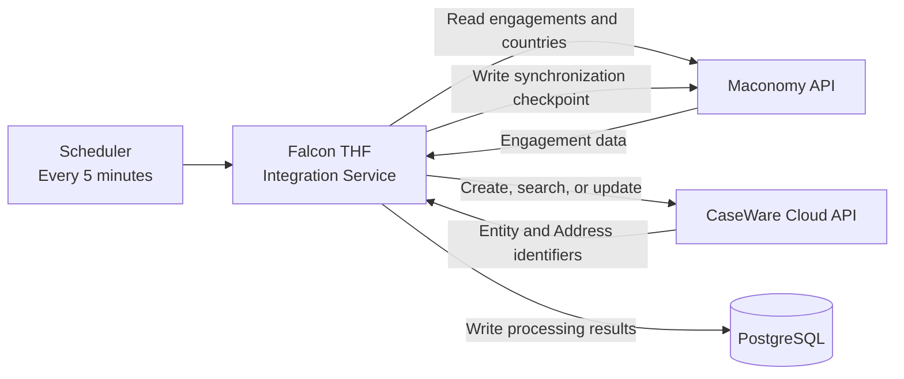
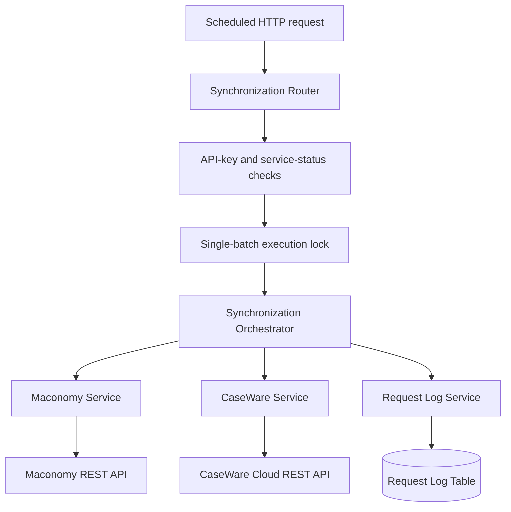
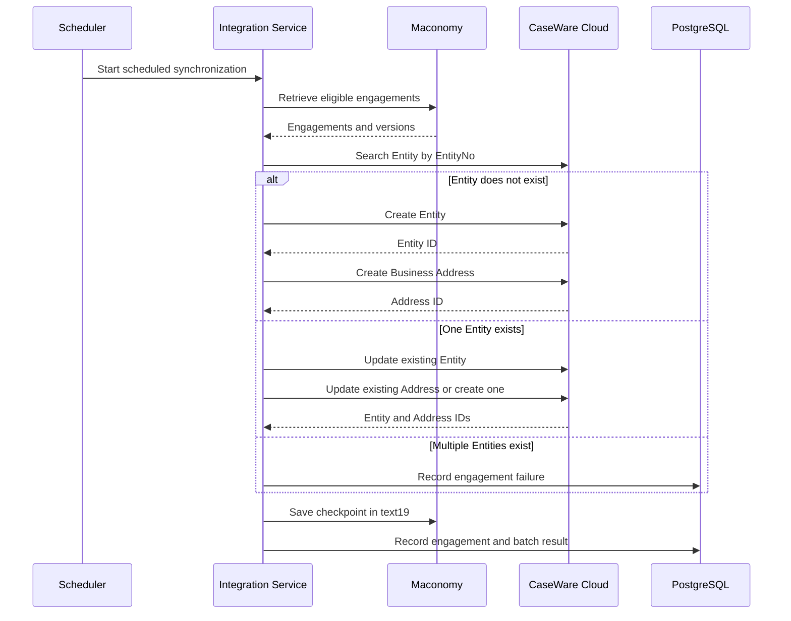
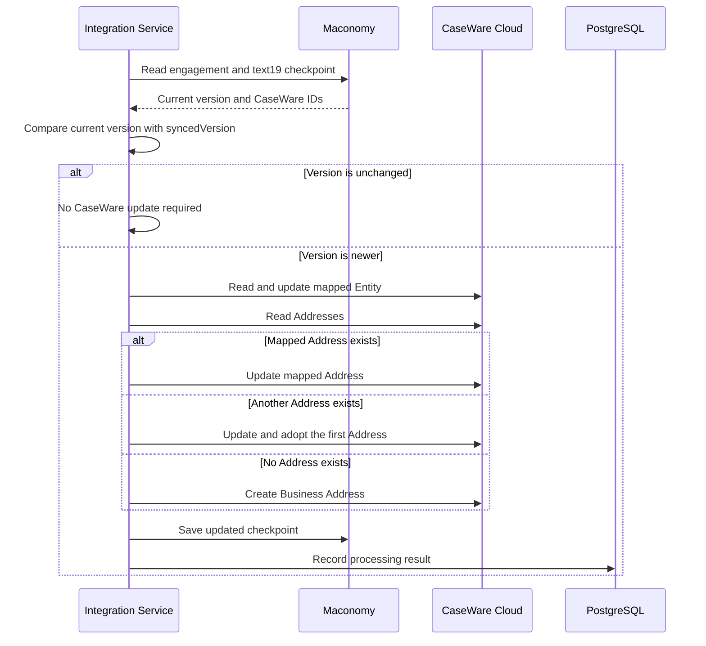

# Maconomy to CaseWare Cloud Integration

## System Design Document

| Document information | Value |
| --- | --- |
| Project | Falcon THF Integration Services |
| Integration | Maconomy to CaseWare Cloud |
| Document type | System Design |
| Status | Draft for client review |

## 1. Purpose

This document describes the technical design of the integration that
synchronizes engagement information from Maconomy to CaseWare Cloud. It covers
the system architecture, components, interfaces, data controls, security,
failure handling, deployment configuration, and operational support model.

The approved business scope and detailed field requirements should be
maintained separately. This document explains how the integration is built and
operated.

## 2. System context

Maconomy is the system of record for engagement information. The integration
service reads eligible engagements, creates or updates the corresponding
CaseWare Entity and Business Address, and writes the CaseWare identifiers back
to the Maconomy engagement.



### System responsibilities

| System | Responsibility |
| --- | --- |
| Scheduler | Starts the scheduled synchronization every five minutes. |
| Maconomy | Owns engagement information, country reference data, record versions, and the CaseWare synchronization checkpoint. |
| Integration Service | Applies eligibility rules, transformations, create/update decisions, synchronization controls, and logging. |
| CaseWare Cloud | Stores the synchronized Entity and its associated Business Address. |
| PostgreSQL | Stores integration-service status and diagnostic execution logs. It does not determine synchronization state. |

## 3. Application architecture



### Component design

| Component | Technical responsibility |
| --- | --- |
| Synchronization Router | Receives the scheduled request, enforces service availability, prevents overlapping batches, and coordinates processing. |
| Maconomy Service | Authenticates with Maconomy, retrieves jobs and country codes, parses checkpoints, and performs concurrency-controlled checkpoint updates. |
| CaseWare Service | Authenticates with CaseWare, searches Entities, creates or updates Entities and Addresses, refreshes expired tokens, and handles rate limits. |
| Request Log Service | Writes one result per processed engagement and one summary per request. |
| Service-status control | Allows the integration to be enabled or disabled without changing the application deployment. |

## 4. Interface design

### Scheduled integration endpoint

| Item | Design |
| --- | --- |
| Method and path | `POST /api/v1/maconomy-caseware-cloud/sync-jobs` |
| Trigger | Application scheduler every five minutes |
| Request body | None |
| Authentication | Integration API key |
| Service control | `MACONOMY_CASEWARE_CLOUD_SYNC` must be active |
| Successful result | List of processed engagement results |
| Concurrent request | Rejected with HTTP `409` while another batch is running |
| Upstream failure | Returned as HTTP `502` when the batch cannot be initialized or completed |

### Maconomy interfaces

| Interface | Purpose |
| --- | --- |
| Authentication | Obtains an X-Reconnect token. |
| Jobs filter | Retrieves eligible engagements created or changed in the processing window. |
| Countries filter | Retrieves country names and two-character ISO codes. |
| Job instance and bind | Reads the latest engagement version and checkpoint before writeback. |
| Job card update | Writes the serialized CaseWare checkpoint to `text19`. |

### CaseWare Cloud interfaces

| Interface | Purpose |
| --- | --- |
| Token authentication | Obtains a bearer token using the configured CaseWare client credentials. |
| Entity search | Finds an Entity using the Maconomy engagement number as `EntityNo`. |
| Entity create/update | Creates a new Entity or updates the mapped Entity. |
| Address list | Retrieves Addresses belonging to an Entity. |
| Address create/update | Creates or updates the Entity's Business Address. |

## 5. Processing design

### 5.1 Candidate selection

The scheduled run requests Maconomy engagements that meet all of the following
conditions:

- `template = false`
- `closed = false`
- `createddate` or `changeddate` is within yesterday and today

The Maconomy request is limited to 2,000 records per run. Jobs that already
have a valid checkpoint are processed only when their current Maconomy version
is greater than the stored synchronized version.

### 5.2 Create or adopt sequence



### 5.3 Update sequence



## 6. Decision logic

| Condition | Action |
| --- | --- |
| `text19` is empty or invalid | Treat the engagement as not yet mapped. |
| No mapped Entity and no matching `EntityNo` | Create an Entity and Address. |
| No mapped Entity but one matching `EntityNo` | Adopt and update the existing Entity and Address. |
| More than one matching Entity | Stop that engagement and record an ambiguity failure. |
| Valid mapping and current version is newer | Update the mapped Entity and Address. |
| Valid mapping and current version is unchanged | Do not send an update to CaseWare. |
| Mapped Address is missing | Stop the update rather than silently selecting a different mapped record. |
| No Address is mapped but an Address exists | Update and adopt the first Address. |
| No Address exists | Create a Business Address. |

## 7. Data design

### 7.1 Entity mapping

| Maconomy source | CaseWare field | Transformation |
| --- | --- | --- |
| `jobnumber` | `EntityNo` | Engagement number in production; `VSKY-` prefix outside production. |
| `jobname` | `Name` | Converted to text. |
| `jobname` | `OperatingName` | Converted to text. |
| `customerremark27` | `EntityFirstName` | First name of customer |
| `customerremark28` | `EntityMiddleName` | Middle name of customer |
| `customerremark29` | `EntityLastName` | Last name of customer |
| `customerremark30` | `suffix` | suffix of customer |
| Resolved country code | `CountryCode` | Trimmed and converted to uppercase. |
| Fixed value | `OwnerType` | `Client` |
| Fixed value | `Type` | `A` |
| Fixed value on creation | `OrganizationType` | `Corporation` |

### 7.2 Address mapping

| Maconomy source | CaseWare field |
| --- | --- |
| `name1` | `Name` |
| `name2` | `Address1` |
| `name3` | `Address2` |
| `name4` | `Address3` |
| `postaldistrict` | `City` |
| `zipcode` | `PostalCode` |
| `telephone` | `PhoneNumber` |
| Country name or ISO value | `Country` |
| Country value for US or Canada | `Province` |
| Fixed value `Business` | `AddressCategory` |

### 7.3 Synchronization checkpoint

Maconomy `text19` contains compact JSON and is the authoritative integration
checkpoint.

```json
{
  "entityId": "CaseWare Entity CWGuid",
  "entityNo": "CaseWare Entity number",
  "syncedVersion": 26,
  "addressId": "CaseWare Address CWGuid",
  "addressNo": 10164,
  "lastUpdateOnUTC": "2026-09-16T14:14:51.389778Z"
}
```

| Field | Purpose |
| --- | --- |
| `entityId` | Identifies the exact CaseWare Entity to update. |
| `entityNo` | Stores the business identifier used for Entity lookup. |
| `syncedVersion` | Identifies the Maconomy version already represented in CaseWare. |
| `addressId` | Identifies the exact CaseWare Address to update. |
| `addressNo` | Stores the CaseWare numeric Address identifier. |
| `lastUpdateOnUTC` | Records when the checkpoint was produced. |

### 7.4 Request log

The `maconomy_caseware_cloud_request_logs` table stores:

- Request ID and Maconomy instance.
- Engagement number.
- Processing action and status.
- Success or failure message.
- Version and checkpoint details.
- UTC creation timestamp.

The log is diagnostic only. Synchronization decisions are based on Maconomy
`versionnumber` and `text19`, not on the database log.

## 8. Security design

| Area | Design |
| --- | --- |
| Scheduled endpoint | Protected by the application's API-key validation. |
| Service availability | Protected by a database-backed integration-service status check. |
| Maconomy authentication | Uses configured credentials to obtain an X-Reconnect token. |
| CaseWare authentication | Uses configured client credentials to obtain a bearer token. |
| Secret handling | Credentials and API keys are loaded from protected runtime configuration and are not stored in documentation or logs. |
| Transport | Both upstream integrations use their configured HTTP or HTTPS endpoints. Production endpoints should use HTTPS. |

## 9. Reliability and consistency controls

### Duplicate and idempotency controls

- `EntityNo` is searched before a new Entity is created.
- `text19` stores the exact Entity and Address identifiers for later updates.
- The Maconomy version prevents unchanged data from being processed again.
- Only one batch can run in an application process at a time.

### Concurrency controls

Before writing `text19`, the integration re-reads the Maconomy engagement and
verifies its expected version and checkpoint. The write uses Maconomy's
concurrency token. After the write, the service verifies that:

- The Maconomy version increased by exactly one.
- The saved checkpoint matches the expected checkpoint.

### Authentication and rate-limit recovery

- Maconomy and CaseWare tokens are reused for a bounded period.
- A rejected CaseWare token is refreshed once before the request fails.
- CaseWare rate-limit responses are retried up to three times.
- The `Retry-After` value is honored when provided; otherwise bounded backoff is
  used.

### Partial-failure recovery

There is no distributed transaction across Maconomy and CaseWare. The
checkpoint is written only after CaseWare processing succeeds. If CaseWare is
updated but the Maconomy checkpoint write fails, a later run searches for the
existing Entity, adopts it, updates it, and attempts the checkpoint again.

A failure for one engagement does not stop the other engagements in the batch.

## 10. Deployment and configuration

The integration is deployed as part of the Falcon THF Integration Services
application. Environment-specific configuration supplies:

- Maconomy base URL, instance short name, username, and password.
- CaseWare Cloud base URL, client ID, client secret, and language.
- Accepted integration API keys.
- PostgreSQL connection settings.
- Scheduler enablement, API base URL, API key, timeout, and five-minute
  CaseWare interval.

The CaseWare integration has a separate service-status record. The service must
be enabled before scheduled requests are accepted.

In the current scheduler sequence, the CaseWare run starts only after the
preceding CCH run completes successfully. A shared scheduler lock prevents
those integration runs from overlapping.

## 11. Monitoring and support

Operational monitoring should review:

- Scheduled execution status.
- Total engagements processed, succeeded, and failed.
- Engagements with `FAILED` status and their error messages.
- Maconomy version and `text19` checkpoint values.
- CaseWare Entity and Address identifiers recorded in the checkpoint.

Recommended support sequence:

1. Confirm that the integration service and scheduler are enabled.
2. Review the request summary and failed engagement log.
3. Confirm the Maconomy engagement's required data, version, and `text19`.
4. Confirm the CaseWare Entity using `entityId` or `entityNo`.
5. Confirm the Address using `addressId` or `addressNo`.
6. Correct the underlying data or service issue and allow the next scheduled
   run to process the engagement.

## 12. Technical constraints and assumptions

### Constraints

- A scheduled Maconomy query returns at most 2,000 engagements.
- The integration maintains one Business Address per engagement.
- The batch lock is process-local; multiple application instances require
  deployment-level coordination to prevent overlapping batches.
- The integration depends on the availability and response contracts of both
  upstream APIs.
- No distributed transaction spans Maconomy and CaseWare.

### Assumptions

- Maconomy engagement numbers are unique and stable.
- Required engagement and address fields are maintained in Maconomy.
- Country names can be resolved to valid two-character ISO codes.
- CaseWare Entity numbers remain unique.
- Network access to Maconomy, CaseWare Cloud, and PostgreSQL is available from
  the integration environment.

## 13. Scope reference

The implemented technical design supports scheduled creation and updates of
one CaseWare Entity and one Business Address for each eligible Maconomy
engagement. Reverse synchronization, deletions, multiple addresses, and other
CaseWare modules are not part of this design.
