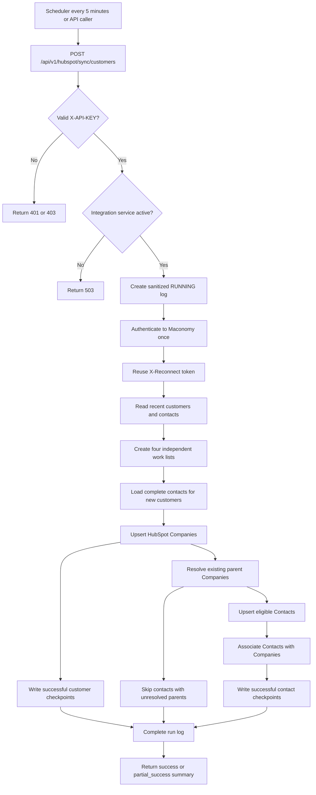

# Maconomy to HubSpot implementation and operational plan

## Document status

- Updated: 2026-10-18
- Implementation status: implemented in the current working tree
- Runtime verification: not performed
- Migration execution: pending manual execution
- Source system: Maconomy
- Destination system: HubSpot CRM
- Direction: Maconomy to HubSpot only
- Deletion and inactive-record synchronization: out of scope

This document records the agreed plan and its current implementation status. It
does not claim that Maconomy or HubSpot has been exercised with live data.

## Implemented scope

| Requirement | Status | Implementation |
|---|---|---|
| Discover recent changes | Implemented | Reads customers and Contact Persons created or changed during a rolling two-day window. |
| Authenticate to Maconomy once per execution | Implemented | A `MaconomyService` caches one `Maconomy-Reconnect` token and reuses it for reads and writebacks during that service execution. |
| Classify customers independently | Implemented | Produces new-customer and updated-customer lists from `versionnumber` and `customerremark26`. |
| Classify contacts independently | Implemented | Produces new-contact-for-existing-customer and updated-contact lists from `versionnumber` and `remark5`. |
| Load all contacts for a new customer | Implemented | Retrieves contacts for new customer numbers in batches of 50 and attaches them to the new-customer records. |
| Upsert HubSpot Companies | Implemented | Batch upsert by `maconomy_customer_number`, chunked to 100 inputs. |
| Upsert HubSpot Contacts | Implemented | Batch upsert by `maconomy_contact_person_number`, chunked to 100 inputs. |
| Connect Contact to Company | Implemented | Resolves the Company and creates the default HubSpot Contact-to-Company association. |
| Maconomy checkpoint writeback | Implemented | Updates the appropriate sync-version field after successful downstream work. |
| Conflict handling | Implemented | Retries one Maconomy concurrency conflict after rebinding the latest record. |
| Scheduled execution | Implemented | Calls the bulk sync at a configurable interval that defaults to five minutes. |
| Manual recovery | Implemented | Provides Customer and Contact Person sync-by-number APIs and web controls. |
| Integration-service control | Implemented | `MACONOMY_HUBSPOT_SYNC` can be enabled or paused from the monitoring UI. |
| Operational logging | Implemented | Stores sanitized run-level counts and failure stages in `hubspot_integration_run_logs`. |
| Monitoring dashboard | Implemented | Displays status, metrics, searchable run history, failure-stage details, and manual retry controls. |

## Business scenario coverage

| Scenario | Implemented behavior |
|---|---|
| New customer with contacts | Upserts the Company, upserts every retrieved Contact Person, associates each successful Contact, and writes independent checkpoints. |
| Updated customer with unchanged contacts | Upserts only the Company and writes only the customer checkpoint. |
| Existing unchanged customer with a new contact | Looks up the existing HubSpot Company, upserts the Contact, creates the association, and writes the contact checkpoint. |
| Existing unchanged customer with an updated contact | Looks up the Company, upserts the Contact, confirms/creates the association, and writes the contact checkpoint. |
| Updated customer with a new or updated contact | Processes the Company and Contact independently; each checkpoint depends on its own successful flow. |
| No actionable version change | Performs no HubSpot write and makes no Maconomy checkpoint change. |
| Parent Company cannot be resolved | Skips the Contact, reports it in the bulk result, and does not write its checkpoint. |
| Contact upsert succeeds but association fails | Reports a partial failure and leaves the Contact checkpoint unchanged. |
| HubSpot succeeds but checkpoint writeback fails | Reports partial success; a later idempotent upsert can retry the checkpoint. |

## Implemented processing flow

## Checkpoint rules

### Customer

- Source version: `versionnumber`
- Sync checkpoint: `customerremark26`
- Blank checkpoint: create candidate
- Source version greater than checkpoint: update candidate
- Equal versions: no action
- Checkpoint greater than source version: skipped as inconsistent
- Writeback value: bound source version plus one

The customer checkpoint is written only after HubSpot confirms the Company
upsert result for that customer.

### Contact Person

- Source version: `versionnumber`
- Sync checkpoint: `remark5`
- Blank checkpoint: create candidate
- Source version greater than checkpoint: update candidate
- Equal versions: no action
- Checkpoint greater than source version: skipped as inconsistent
- Writeback value: bound source version plus one

The Contact Person checkpoint is written only after HubSpot confirms the
Contact upsert and the Contact-to-Company association succeeds.

### Conflict retry

Writeback binds the Maconomy record and sends its concurrency token. HTTP 409
or 412 causes one rebind-and-retry attempt. After saving, the implementation
verifies both of the following:

1. `versionnumber` increased by exactly one.
2. The checkpoint contains the expected source version plus one.

## API surface

All three endpoints require:

- `X-API-KEY` with an accepted application API key.
- An active `MACONOMY_HUBSPOT_SYNC` integration-service record.

| Method and path | Purpose | Run operation |
|---|---|---|
| `POST /api/v1/hubspot/sync/customers` | Scheduled or API-triggered two-day bulk synchronization. | `BULK_SYNC` |
| `POST /api/v1/hubspot/customers/{customer_number}/sync` | Manually upsert one Customer and all its Contact Persons. | `CUSTOMER_RETRY` |
| `POST /api/v1/hubspot/contacts/{contact_person_number}/sync` | Manually upsert one Contact Person and associate it with its existing Company. | `CONTACT_RETRY` |

The scheduler adds `X-Integration-Trigger: SCHEDULER`. A direct bulk API call
without that value is logged with trigger `API`. Manual record endpoints are
logged with trigger `MANUAL`.

## Scheduler plan

The implemented scheduler job has these controls:

- Job ID: `maconomy_hubspot_sync`
- Default interval: five minutes
- Configuration: `SCHEDULER_HUBSPOT_INTERVAL_MINUTES`
- API target: `POST /api/v1/hubspot/sync/customers`
- Shared scheduler authentication: `SCHEDULER_API_KEY`
- Maximum concurrent instances: one
- Missed intervals: coalesced
- Misfire grace time: 60 seconds
- Shared integration lock: serializes this job with the scheduler service's
  other integration jobs

The job runs only when `SCHEDULER_ENABLED` is true. The API also refuses the
run until the integration-service record is active.

## Logging and monitoring plan

Every accepted HubSpot execution attempts to create one
`hubspot_integration_run_logs` row. The log contains operational metadata and
counts only:

- Request ID, operation, trigger, status, and Maconomy instance
- Start and completion timestamps
- Customer and Contact Person discovered/succeeded counts
- Association and checkpoint success counts
- Skipped and failed counts
- Summary, failure stage, sanitized error message, and stage-count JSON
- Failed/skipped record references containing the entity type, Maconomy
  Customer or Contact Person number, and sanitized stage/reason
- A `record_results` ledger with one final `SUCCESS`, `FAILED`, or `SKIPPED`
  status per processed Customer or Contact Person; Contact rows also retain the
  parent Customer number when available

Raw Customer or Contact Person payloads are not stored in this table. Only the
Maconomy record number needed for operational recovery is stored for failed or
skipped records. Manual retry user-activity entries store the record type and
integration ID, not the Customer or Contact Person number.

The web dashboard uses the common integration-monitor theme and provides:

- Service activation and pause control
- Recent-run count and success rate
- Total records synchronized
- Attention-required count
- Searchable and paginated run history
- Affected Customer and Contact Person numbers in run history and run details
- A complete per-record status table separating Customer number, Contact Person
  number, outcome, final stage, and sanitized message
- Sanitized failure-stage details
- Manual retry for one Customer or Contact Person

For monitoring, `SUCCESS` is an end-to-end status. A Customer is successful
only after Company upsert and Customer checkpoint writeback. A Contact Person is
successful only after Contact upsert, Company association, and Contact
checkpoint writeback.

## Deployment checklist

- [ ] Review and apply `20261018_0025_hubspot_integration_run_logs.py`.
- [ ] Review and apply `20261018_0026_register_maconomy_hubspot_sync.py`.
- [ ] Configure `HUBSPOT_SERVICE_KEY` and confirm required private-app scopes.
- [ ] Confirm HubSpot custom properties `maconomy_customer_number` and
  `maconomy_contact_person_number` exist and are usable as unique IDs.
- [ ] Set `SCHEDULER_API_KEY` to an accepted application API key.
- [ ] Set `SCHEDULER_ENABLED=true` where scheduled execution is required.
- [ ] Set or accept `SCHEDULER_HUBSPOT_INTERVAL_MINUTES=5`.
- [ ] Activate `MACONOMY_HUBSPOT_SYNC` from the monitoring screen.
- [ ] Perform controlled Maconomy and HubSpot verification.

## Current known limitations

1. Maconomy filter reads use `limit: 5000` and do not implement pagination.
2. The Company mapper supports `zipcode`, `name2`, and `postaldistrict`, but
   those fields are not currently included in `CUSTOMER_CARD_FIELDS`; those
   HubSpot values therefore remain absent unless the source query is extended.
3. HubSpot retries HTTP 429 up to three total attempts. Network errors and HTTP
   5xx responses are not automatically retried.
4. Contact reassignment does not remove a previous HubSpot Company association;
   the code creates or preserves the association to the current parent.
5. Delete, archive, and inactive-record propagation is intentionally out of
   scope.
6. Run logging is best effort. A database logging failure does not stop the
   synchronization itself.
7. The implementation has not been validated by an application run, migration
   execution, automated tests, or live upstream calls as part of this work.

## Definition of operational completion

The feature is operationally complete when the migrations are applied, required
configuration and HubSpot properties are confirmed, the integration service is
activated, and controlled verification confirms discovery, upsert, association,
writeback, logging, scheduler, manual retry, and dashboard behavior.
