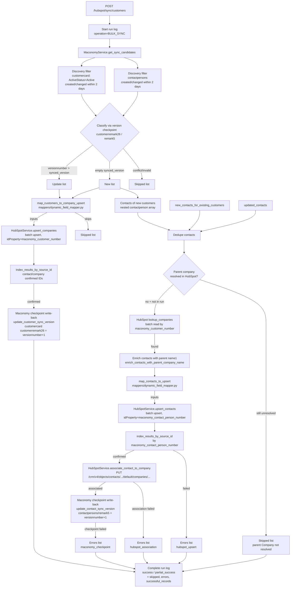

# HubSpot Integration — Current State

Source of truth: `backend/app/features/hubspot_integration`

**Direction:** Maconomy → HubSpot (one-way). HubSpot is never a data source.

**Sync window:** last 2 days (`createddate`/`changeddate`) — `maconomy_service.py:21`

---

## 1. Endpoints

| Endpoint | File | Purpose |
|---|---|---|
| `POST /hubspot/sync/customers` | `routers/get_recent_customers_contacts.py` | Bulk sync of changed Customers + Contacts (BULK_SYNC, trigger: API/SCHEDULER) |
| `POST /hubspot/customers/{customer_number}/sync` | `routers/get_recent_customers.py` | Manual retry of one Customer + all its Contacts (CUSTOMER_RETRY) |
| `POST /hubspot/contacts/{contact_person_number}/sync` | `routers/get_recent_customers.py` | Manual retry of one Contact + association (CONTACT_RETRY) |

All endpoints: `X-API-Key` required + integration service `MACONOMY_HUBSPOT_SYNC` must be active. Each run is logged to `integration_run_log` (`services/integration_run_log_service.py`).

---

## 2. Bulk Sync Flow (Maconomy → HubSpot)

Key classification logic (`maconomy_service.py:_get_sync_decision`):
- Checkpoint field empty → **create** (new)
- `versionnumber > checkpoint value` → **update**
- Any conflict/invalid → **skipped** (never synced again)

---

## 3. Manual Retry Flows

### Customer (CUSTOMER_RETRY)
1. Fetch Maconomy customer + all its contacts (`get_customer_with_contact_persons`, filter `customernumber`, ActiveStatus=Active).
2. Upsert Company → checkpoint write-back → upsert all Contacts → associate each to Company → checkpoint each contact.

### Contact (CONTACT_RETRY)
1. Fetch Maconomy contact person by `contactpersonnumber`.
2. Resolve parent Customer number (`contactcompanynumber`); 422 if missing.
3. `lookup_companies` in HubSpot (must already exist; 404 if not).
4. Enrich + map + upsert Contact → associate to Company → checkpoint write-back.

---

## 4. HubSpot API calls (`services/hubspot_service.py`)

| Call | HubSpot Endpoint | Notes |
|---|---|---|
| Company batch upsert | `POST /crm/objects/2026-09/companies/batch/upsert` | `idProperty=maconomy_customer_number`, batch size 100, 429 retry ≤3 (Retry-After header) |
| Company batch read (lookup) | `POST /crm/objects/2026-09/companies/batch/read` | `idProperty=maconomy_customer_number` |
| Contact batch upsert | `POST /crm/objects/2026-09/contacts/batch/upsert` | `idProperty=maconomy_contact_person_number` |
| Contact→Company association | `PUT /crm/v4/objects/contacts/{id}/associations/default/companies/{company_id}` | idempotent |
| Auth | `Authorization: Bearer {HUBSPOT_SERVICE_KEY}` | 401 → `HubSpotAuthError` |

Result confirmation: `index_results_by_source_id` matches `objectWriteTraceId` (`company-{customer_number}` / `contact-{contact_person_number}`) or the source-ID property.

---

## 5. Field Mapping — Maconomy Customer Card → HubSpot Company

Source: `mappers/dynamic_field_mapper.py` → `COMPANY_FIELD_MAPPING`
Dedup key: `maconomy_customer_number` = Maconomy `customernumber`
Empty/None values are omitted from `properties`.

| Maconomy field | HubSpot Company property | Notes |
|---|---|---|
| `customernumber` | `maconomy_customer_number` | Upsert `idProperty` + `id` |
| `name1` | `name` | |
| `telephone` | `phone` | |
| `country` | `country` | |
| `zipcode` | `zip` | |
| `name2` | `address` | |
| `postaldistrict` | `city` | |
| `name3` | `address2` | |

---

## 6. Field Mapping — Maconomy Contact Person → HubSpot Contact

Source: `mappers/dynamic_field_mapper.py` → `CONTACT_FIELD_MAPPING`
Dedup key: `maconomy_contact_person_number` = Maconomy `contactpersonnumber` (NOT email; the static `contact_mapper.py` sample keyed by `email` is unused by the sync endpoints).
Empty/None values are omitted from `properties`.

| Maconomy field | HubSpot Contact property | Notes |
|---|---|---|
| `contactpersonnumber` | `maconomy_contact_person_number` | Upsert `idProperty` + `id` |
| `contactcompanynumber` | `maconomy_customer_number` | Parent customer number |
| `electronicmailaddress` | `email` | Standard email property |
| `firstname` | `firstname` | |
| `lastname` | `lastname` | |
| `telephone` | `phone` | |
| `position` | `jobtitle` | |
| `parent_customer_name1` | `company` | Injected parent Customer `name1` via enrichment (only if parent name resolved) |
| `name2` | `address` | |
| `name3` | `street_address_2` | |
| `mobilephone` | `mobilephone` | |
| `country` | `country` | |
| `personaltitle` | `name_prefix` | |

---

## 7. Maconomy Checkpoints (write-back)

Prevents re-syncing unchanged records; also forces Maconomy record version bump.

| Entity | Checkpoint field (written) | Target container | Value written |
|---|---|---|---|
| Customer | `customerremark26` | `customercard` | `versionnumber + 1` (as string) |
| Contact | `remark5` | `contactpersons` | `versionnumber + 1` (as string) |

Written ONLY after successful HubSpot upsert (customer) or upsert + association (contact), with optimistic concurrency (`Maconomy-Concurrency-Control`); conflict → single retry, else recorded as `maconomy_checkpoint` error and re-synced next run.

---

## 8. Run States / Result

| Status | Meaning |
|---|---|
| `success` | No errors, no unresolved contacts |
| `partial_success` | Some records skipped/failed; successful ones checkpointed |
| Hard failure (502/404/422) | `fail_run` with `failure_stage`: `MACONOMY_DISCOVERY`, `HUBSPOT_COMPANY_UPSERT`, `HUBSPOT_COMPANY_LOOKUP`, `HUBSPOT_CONTACT_UPSERT`, `HUBSPOT_ASSOCIATION`, etc. |

Error/stage labels seen in run log: `maconomy_customer_lookup`, `contact_validation`, `company_mapping`, `contact_mapping`, `maconomy_checkpoint`, `hubspot_upsert`, `hubspot_association`, `hubspot_company_lookup`.

---

---

# 9. PROPOSED / TARGET STATE

The proposed scope (parallel Company/Contact sync, email de-duplication with master contact routing, multi-company associations) has been moved to its own plan document: **[proposed_scope_hubspot.md](./proposed_scope_hubspot.md)** (design only - not yet implemented).
