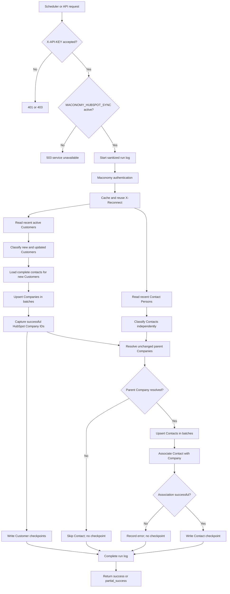
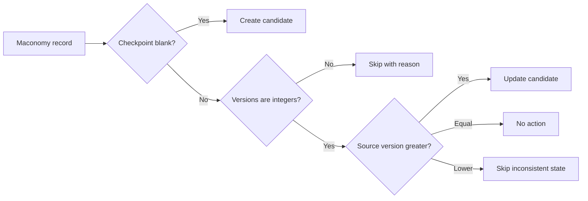

# Maconomy to HubSpot integration: current development status

## Assessment summary

This document describes the implementation present in the working tree on
2026-10-18. It is based on code inspection. The application, migrations,
automated tests, Maconomy calls, and HubSpot calls were not executed as part of
this assessment.

**Overall code status: implemented, pending deployment and runtime verification.**

The integration now supports scheduled and manual Maconomy-to-HubSpot
synchronization for Customers and Contact Persons. It discovers recent changes,
classifies work independently, upserts Companies and Contacts, creates their
HubSpot association, writes successful sync checkpoints back to Maconomy, logs
sanitized execution summaries, and exposes a monitoring dashboard.

## Scope

Included:

- One-way synchronization from Maconomy to HubSpot
- Active Maconomy Customers created or changed in the last two days
- Contact Persons created or changed in the last two days
- All Contact Persons belonging to a newly created Customer
- HubSpot Company and Contact upsert
- Contact-to-Company association
- Maconomy sync-version writeback
- Five-minute scheduled execution
- Manual retry by Customer number or Contact Person number
- Integration-service activation control
- Database run logging and web monitoring

Not included:

- HubSpot-to-Maconomy synchronization
- Maconomy deletion, archive, or inactive-record propagation
- Removal of old HubSpot associations when a Contact changes parent Company

## Implementation status

| Area | Status | Current implementation |
|---|---|---|
| Configuration | Implemented | HubSpot URL/key and scheduler interval settings are defined. |
| API authentication | Implemented | All HubSpot integration APIs require `X-API-KEY`. Missing keys return 401 and invalid keys return 403. |
| Service activation | Implemented | All HubSpot integration APIs require active service identifier `MACONOMY_HUBSPOT_SYNC`; inactive or missing configuration returns 503. |
| Maconomy authentication | Implemented | Uses Basic authentication to obtain `Maconomy-Reconnect`; one token is cached and reused by the service execution. |
| Discovery window | Implemented | Uses `date.today() - 2 days` for Customer and Contact Person filters. |
| Customer classification | Implemented | Separates new and updated Customers using `customerremark26`. |
| Contact classification | Implemented | Separates new Contacts for existing Customers and updated Contacts using `remark5`. |
| New-customer contacts | Implemented | Loads the complete Contact Person list for new Customers in groups of 50 customer numbers. |
| Company mapping/upsert | Implemented | Upserts by `maconomy_customer_number`; HubSpot requests are chunked to 100 records. |
| Contact mapping/upsert | Implemented | Upserts by `maconomy_contact_person_number`; HubSpot requests are chunked to 100 records. |
| Existing Company lookup | Implemented | Batch reads Companies using `maconomy_customer_number`. |
| Contact association | Implemented | Uses the HubSpot v4 default Contact-to-Company association endpoint. |
| Customer checkpoint | Implemented | Writes `customerremark26` after successful Company upsert. |
| Contact checkpoint | Implemented | Writes `remark5` only after Contact upsert and Company association succeed. |
| Conflict retry | Implemented | Rebinds and retries one Maconomy 409/412 conflict, then verifies the saved checkpoint/version. |
| Scheduler | Implemented | APScheduler calls the bulk sync at a configurable five-minute default interval. |
| Manual APIs | Implemented | Customer-with-contacts and individual Contact Person retry endpoints are registered. |
| Run logging | Implemented | Sanitized run summaries are stored in `hubspot_integration_run_logs`. |
| Integration registry | Implemented | Alembic registers the service as inactive by default. |
| Monitoring UI | Implemented | Service list, activation, metrics, run history, failure details, and manual retry controls are available. |

## Registered API endpoints

### Bulk synchronization

`POST /api/v1/hubspot/sync/customers`

Purpose:

- Discover and classify the last two days of Maconomy Customer and Contact
  Person changes.
- Upsert eligible records into HubSpot.
- Associate Contacts with Companies.
- Write successful checkpoints to Maconomy.

Headers:

| Header | Required | Meaning |
|---|---:|---|
| `X-API-KEY` | Yes | Application API key. |
| `X-Integration-Trigger` | No | `SCHEDULER` records the run as scheduled; other/missing values record `API`. |
| `X-Request-ID` | No | Request correlation ID when supported by request middleware. |

Successful response shape:

```json
{
  "status": "success",
  "sync_window_days": 2,
  "classification": {
    "new_customers": 1,
    "updated_customers": 2,
    "new_contacts_for_existing_customers": 3,
    "updated_contacts": 1,
    "contacts_for_new_customers": 2
  },
  "hubspot": {
    "companies_requested": 3,
    "companies_succeeded": 3,
    "contacts_requested": 6,
    "contacts_succeeded": 6,
    "contacts_associated": 6
  },
  "maconomy_checkpoints": {
    "customers": 3,
    "contacts": 6
  },
  "skipped": [],
  "errors": []
}
```

`status` becomes `partial_success` when per-record association, batch, or
checkpoint errors occur, or when a Contact's parent Company cannot be resolved.
An upstream failure that prevents a trustworthy result returns HTTP 502.

### Manual Customer synchronization

`POST /api/v1/hubspot/customers/{customer_number}/sync`

Behavior:

1. Reads one active Maconomy Customer.
2. Reads all Contact Persons for that Customer.
3. Upserts the HubSpot Company.
4. Writes the customer checkpoint.
5. Upserts and associates each successful Contact Person.
6. Writes successful contact checkpoints.

The endpoint is logged as operation `CUSTOMER_RETRY` with trigger `MANUAL`.
A missing Customer returns HTTP 404. Mapping validation returns HTTP 422.

### Manual Contact Person synchronization

`POST /api/v1/hubspot/contacts/{contact_person_number}/sync`

Behavior:

1. Reads one Maconomy Contact Person.
2. Resolves its existing HubSpot Company by Maconomy customer number.
3. Upserts the Contact.
4. Creates or preserves the Contact-to-Company association.
5. Writes the contact checkpoint.

The endpoint is logged as operation `CONTACT_RETRY` with trigger `MANUAL`.
A missing Contact or parent Company returns HTTP 404. Missing parent data or
mapping validation returns HTTP 422.

## End-to-end runtime flow



## Selection logic

The same version decision applies independently to a Customer or Contact
Person, using the entity-specific checkpoint field.



The four processing categories are:

1. `new_customers`, including complete Contact Person lists.
2. `updated_customers`.
3. `new_contacts_for_existing_customers`.
4. `updated_contacts`.

Contacts attached to a new Customer are excluded from standalone Contact lists
and deduplicated by `contactpersonnumber`.

## Maconomy behavior

### Authentication

The service calls:

`GET {MACONOMY_URL}/maconomy-api/auth/{shortname}/login`

It sends Basic credentials plus `Maconomy-Authentication: X-Reconnect`. The
returned `Maconomy-Reconnect` header is cached on the `MaconomyService` and used
as `Authorization: X-Reconnect {token}` for the remaining calls in that
execution.

### Discovery

- Customer container: `customercard`
- Contact container: `contactpersons`
- Window: today minus two days
- Per-filter limit: 5,000
- Customer restriction includes `ActiveStatus = Active`
- Recent Contact restriction does not include an active-status condition
- Complete contacts for new Customers are fetched in customer batches of 50

### Checkpoint writeback

| Entity | Key | Checkpoint |
|---|---|---|
| Customer | `customernumber` | `customerremark26` |
| Contact Person | `contactpersonnumber` | `remark5` |

The implementation creates a container instance, binds the exact record, uses
`Maconomy-Concurrency-Control`, writes bound `versionnumber + 1` into the
checkpoint, and verifies the saved record. One 409/412 conflict is retried by
rebinding without the original expected-version requirement.

## HubSpot behavior

### Authentication and retry

- Authentication: `Authorization: Bearer {HUBSPOT_SERVICE_KEY}`
- HTTP 401: fails immediately with a key/scope error
- HTTP 429: retries using `Retry-After`, with three total attempts and a
  60-second maximum delay
- Other unsuccessful statuses: fail without automatic retry
- Accepted success statuses: 200, 201, 204, and 207

### API operations

| Operation | HubSpot path |
|---|---|
| Company batch upsert | `/crm/objects/2026-09/companies/batch/upsert` |
| Company batch read | `/crm/objects/2026-09/companies/batch/read` |
| Contact batch upsert | `/crm/objects/2026-09/contacts/batch/upsert` |
| Contact-to-Company association | `/crm/v4/objects/contacts/{contact_id}/associations/default/companies/{company_id}` |

Company and Contact upserts are split into chunks of 100. The mapper adds an
`objectWriteTraceId` so successful HubSpot results can be reconciled with the
source record before checkpoint writeback.

## Field mapping

### Company

| Maconomy field | HubSpot property | Current source-query status |
|---|---|---|
| `customernumber` | `maconomy_customer_number` | Requested and mapped; upsert ID. |
| `name1` | `name` | Requested and mapped. |
| `telephone` | `phone` | Requested and mapped. |
| `country` | `country` | Requested and mapped. |
| `zipcode` | `postalcode` | Mapper supports it, but the current query does not request it. |
| `name2` | `sheetaddress` | Mapper supports it, but the current query does not request it. |
| `postaldistrict` | `city` | Mapper supports it, but the current query does not request it. |

### Contact Person

| Maconomy field | HubSpot property | Current source-query status |
|---|---|---|
| `contactpersonnumber` | `maconomy_contact_person_number` | Requested and mapped; upsert ID. |
| `contactcompanynumber` | `maconomy_customer_number` | Requested and mapped. |
| `electronicmailaddress` | `email` | Requested and mapped. |
| `firstname` | `firstname` | Requested and mapped. |
| `lastname` | `lastname` | Requested and mapped. |
| `telephone` | `phone` | Requested and mapped. |
| `position` | `jobtitle` | Requested and mapped. |

Empty optional values are omitted. Missing unique identifiers are reported as
mapping skips.

## Scheduler

The existing application lifespan starts `SchedulerService`. When
`SCHEDULER_ENABLED` is true, it registers the HubSpot interval job:

| Setting | Value |
|---|---|
| Job ID | `maconomy_hubspot_sync` |
| Endpoint | `/api/v1/hubspot/sync/customers` |
| Default interval | 5 minutes |
| Interval setting | `SCHEDULER_HUBSPOT_INTERVAL_MINUTES` |
| Authentication | Shared `X-API-KEY` from `SCHEDULER_API_KEY` |
| Trigger marker | `X-Integration-Trigger: SCHEDULER` |
| Maximum instances | 1 |
| Coalescing | Enabled |
| Misfire grace | 60 seconds |

The scheduler also uses the scheduler service's shared integration lock, so the
HubSpot job does not execute concurrently with the other jobs managed by that
service instance.

## Database logging

Migration `20261018_0025_hubspot_integration_run_logs.py` creates
`hubspot_integration_run_logs`.

Stored fields:

- `id`, `request_id`, `operation`, `trigger_type`, `status`
- `maconomy_instance`, `started_on_utc`, `completed_on_utc`
- Customer and Contact Person discovered/succeeded counts
- Association and checkpoint success counts
- Skipped and failed counts
- `summary_message`, `failure_stage`, `error_message`, `details`

`details` stores count summaries, failure-stage counts, and sanitized
`failed_records`/`skipped_records` arrays, plus a `record_results` ledger. The
ledger contains one final `SUCCESS`, `FAILED`, or `SKIPPED` row per processed
Customer or Contact Person. Contact rows include the parent Customer number when
available. Entries contain only identifiers and sanitized operational context;
raw Customer/Contact payloads are not stored. Run-log writes are best effort and
do not abort the integration if logging itself fails.

## Integration-service registration

Migration `20261018_0026_register_maconomy_hubspot_sync.py` adds:

| Field | Value |
|---|---|
| Identifier | `MACONOMY_HUBSPOT_SYNC` |
| Display name | `Maconomy to HubSpot sync` |
| Source | `Maconomy` |
| Target | `HubSpot` |
| Initial status | Inactive |

Once the migration is applied, the generic integration list displays the
service. An operator must activate it before scheduled or manual APIs can run.

## Web monitoring

The HubSpot detail page follows the CCH monitoring theme and provides:

- Active/inactive status and source-to-target route
- Recent run count
- Run success rate
- Total Customers plus Contacts synchronized
- Attention-required count from skipped and failed items
- Searchable, paginated run history
- Customer, Contact, association, checkpoint, skip, and failure counts
- Affected Maconomy Customer and Contact Person numbers in the run table
- Complete per-record Customer/Contact status with separate Customer number and
  Contact Person number columns
- Failed/skipped record lists with stage or reason in the detail modal
- Sanitized failure-stage detail modal
- Integration activation/pause control
- Manual retry form for either Customer or Contact Person

Dashboard manual retries call the existing API endpoints with the scheduler API
key and request ID. User activity records include record type and integration
ID, but not the Customer or Contact Person number.

Per-record `SUCCESS` means end-to-end completion. Customer success requires the
Company upsert and Maconomy Customer checkpoint. Contact Person success requires
the Contact upsert, Company association, and Maconomy Contact checkpoint.

## Error behavior

| Condition | Behavior |
|---|---|
| Missing `X-API-KEY` | HTTP 401 |
| Invalid `X-API-KEY` | HTTP 403 |
| Integration record missing or inactive | HTTP 503 |
| Maconomy discovery/authentication failure | HTTP 502 and failed run log |
| HubSpot Company/Contact request failure | HTTP 502 and failed run log |
| Existing Company lookup failure | HTTP 502 and failed run log |
| Manual source record not found | HTTP 404 |
| Missing parent or mapping validation | HTTP 422 |
| Per-record association/checkpoint failure | HTTP 200 response with `partial_success` and run log status `PARTIAL_SUCCESS` |
| Unresolved parent during bulk sync | Contact skipped, no checkpoint, response `partial_success` |

## Current limitations and risks

1. Maconomy filter operations stop at 5,000 records and have no continuation or
   pagination logic.
2. Three Company mapper fields are not requested by the current Customer query:
   `zipcode`, `name2`, and `postaldistrict`.
3. HTTP 429 is retried, but network failures and HTTP 5xx responses are not.
4. A moved Contact can gain the new Company association, but the previous
   Company association is not removed.
5. The source date window uses the application server's `date.today()`; there is
   no explicit business timezone setting for the boundary.
6. Runtime compatibility with the configured HubSpot API version, scopes,
   unique custom properties, and Maconomy containers remains unverified.
7. No application execution, migration execution, test execution, or live
   upstream call was performed while preparing this documentation.

## Deployment prerequisites

1. Apply migration `20261018_0025` to create the HubSpot run-log table.
2. Apply migration `20261018_0026` to register the integration service.
3. Configure a valid `HUBSPOT_SERVICE_KEY` and verify its scopes.
4. Verify the HubSpot unique properties used for upsert and lookup.
5. Configure `SCHEDULER_API_KEY` as an accepted application key.
6. Enable the scheduler where required.
7. Activate `MACONOMY_HUBSPOT_SYNC` from the monitoring UI.
8. Perform controlled functional verification before production use.

## Primary code locations

- `app/features/hubspot_integration/routers/get_recent_customers_contacts.py`
- `app/features/hubspot_integration/routers/get_recent_customers.py`
- `app/features/hubspot_integration/services/maconomy_service.py`
- `app/features/hubspot_integration/services/hubspot_service.py`
- `app/features/hubspot_integration/services/integration_run_log_service.py`
- `app/features/hubspot_integration/mappers/dynamic_field_mapper.py`
- `app/features/hubspot_integration/models/integration_run_log.py`
- `app/features/schedular_services/scheduler.py`
- `app/features/schedular_services/services/hubspot_sync.py`
- `app/web/routes.py`
- `app/templates/maconomy_hubspot_dashboard.html`
- `alembic/versions/20261018_0025_hubspot_integration_run_logs.py`
- `alembic/versions/20261018_0026_register_maconomy_hubspot_sync.py`
