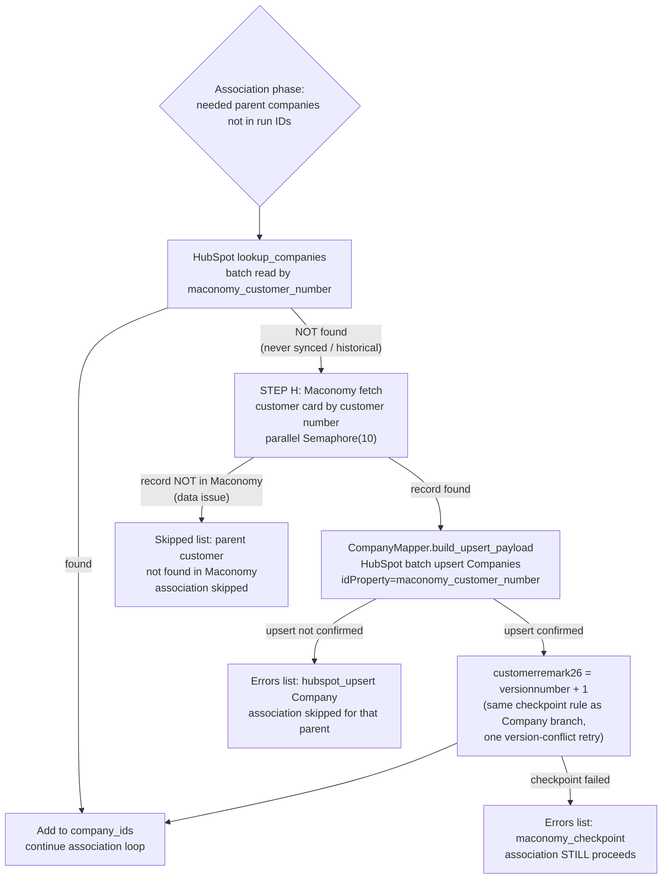

# HubSpot Integration — Proposed Scope Plan (design only — not yet implemented)

Status: **SCOPED PLAN — awaiting implementation.** The live behavior is documented in `current_state_hubspot.md` (Sections 1–8).

Scope summary: parallel Company ∥ Contact creation, email de-duplication with one "master" contact person per email group, `remark4` routing/pointers, and one-HubSpot-contact-to-many-companies associations. No version write-back for mapping (association) operations.

---

## 1. Target Flow

```mermaid
flowchart TD
    A[POST /hubspot/sync/customers] --> B[Maconomy discovery:<br/>fetch CUSTOMERS and CONTACT PERSONS in PARALLEL<br/>then wait for BOTH to complete]
    B -->|"Query 1 - customers"| C1["(ActiveStatus = ActiveType'Active) and<br/>(createddate >= D or changeddate >= D)<br/>D = today minus 2 days"]
    B -->|"Query 2 - contact persons<br/>parallel fetch"| C2["(contactcompanynumber != 'null' and<br/>electronicmailaddress != 'null') and<br/>(createddate >= D or changeddate >= D)<br/>D = today minus 2 days"]
    C1 --> W[WAIT: both discovery queries complete]
    C2 --> W
    W --> C[Classify via customerremark26 / remark5<br/>new / updated / skipped]
    C --> D{Split into 2 branches}

    D -->|new + updated CUSTOMERS<br/>incl. their contact lists| E[Branch 1: Companies]
    D -->|new + updated CONTACTS<br/>incl. contacts of new customers| F[Branch 2: Contacts]

    E --> G[map_customers_to_company_upsert] --> H[HubSpot batch upsert Companies<br/>idProperty=maconomy_customer_number]
    H --> I1[customer checkpoint<br/>customerremark26 = versionnumber + 1]

    F --> I[STEP A: Email de-dup grouping<br/>group key = electronicmailaddress]
    I --> RR[STEP B: Resolve MASTER per group<br/>master may predate the 2-day window]
    RR -->|"remark4 already set<br/>on any group member"| MR1[MASTER = number stored in remark4]
    RR -->|"remark4 empty on ALL members<br/>ONLY these groups"| RQ[STEP B2: email back-query<br/>5 emails per batch, parallel requests<br/>fetch the FULL group from Maconomy]
    RQ --> UN[Union all result records<br/>by contactpersonnumber]
    UN --> GM{remark4 present<br/>on any union record?}
    GM -->|yes| MR1
    GM -->|no| RE[Elect MASTER<br/>first / lowest contactpersonnumber]
    RE --> SYNC[STEP C: master has no HubSpot image<br/>create it]
    MR1 --> MD{master's own record in the<br/>changed list AND master already synced?}
    MD -->|"master NOT in changed list<br/>no master update"| STAMP[STAMP-ONLY group:<br/>remark4 = master contactpersonnumber string<br/>on members with EMPTY remark4 only<br/>NO HubSpot Contact record added or updated]
    MD -->|"master IS in changed list<br/>master updated"| SYNC
    SYNC --> L[HubSpot batch upsert Contacts<br/>idProperty=maconomy_contact_person_number<br/>only masters being created / updated]
    L --> MW[STEP D: remark4 write-back<br/>Stamp remark4 on members with EMPTY remark4 only<br/>already-stamped members left untouched]

    I1 --> N{JOIN: BOTH branches done?}
    MW --> N
    STAMP --> N

    N --> O[STEP E: Association phase<br/>runs for ALL groups that need mapping:<br/>newly synced groups AND stamp-only groups<br/>per group collect parent companies<br/>contactcompanynumber of master + every non-master]
    O --> P[Resolve company IDs<br/>from upsert results or HubSpot batch lookup]
    P --> PM{Parent companies NOT found<br/>in run IDs or HubSpot?<br/>STEP H: Historical Parent Recovery,<br/>8.2 pending approval}
    PM -->|"all parents resolved"| Q
    PM -->|"lookup misses"| HR["STEP H: fetch customer cards<br/>from Maconomy by customer number<br/>parallel Semaphore(10), no window filter"]
    HR -->|"customer found"| HU[HubSpot batch upsert recovered Companies<br/>then customerremark26 = versionnumber + 1<br/>one conflict retry]
    HU --> Q
    HR -->|"customer NOT in Maconomy"| HS[Skipped list:<br/>parent customer not found<br/>association skipped]
    P --> Q[STEP F: HubSpot associations<br/>one master contact to MANY companies<br/>If master already exists: associate now<br/>If master was just created: associate after its upsert is confirmed]

    Q --> S[Complete run log<br/>success / partial_success<br/>incl. historical_parent_recovery ledger entries]
```



**Phase structure:**
- **Phase 0** — parallel Maconomy discovery (customers ∥ contact persons), barrier before classification.
- **Phase 1** — parallel: Companies branch ∥ Contacts branch (dedup → master resolution → upsert → stamping), each with its own checkpoint.
- **Phase 2** — associations only after Phase 1 completes (both branches joined). Pure mapping; no Maconomy writes here. Includes **STEP H (historical parent recovery)**: parents missing in HubSpot are fetched from Maconomy by customer number, created as Companies (with `customerremark26` checkpoint), before the association loop runs.

---

## 2. Parallel Discovery (STEP B prerequisite)

Customers and contact persons are fetched from Maconomy **in parallel at the start
of the run** — they are two independent containers/tables:

| Query | Maconomy filter restriction |
|---|---|
| Customers | `(ActiveStatus = ActiveType'Active) and (createddate >= D or changeddate >= D)` — unchanged from today |
| Contact persons | `(contactcompanynumber != 'null' and electronicmailaddress != 'null') and (createddate >= D or changeddate >= D)` |

Both queries use the same 2-day date filter (`D = today − 2 days`), run
concurrently, and the run **waits for both to complete** before classification (`asyncio.gather`).

---

## 3. Email De-Duplication & MASTER Routing

### 3.1 MASTER resolution (STEP B / B2) — why and how

The master of an email group may be **older than the 2-day sync window**, so it is
not present in discovery.

```
email1  contact1  11/12/2026   ← true master, OUTSIDE the 2-day window
email1  contact2  20/12/2026   ← inside window; contact1 is its master
```

Resolution procedure (optimized: back-query only when needed):

1. **First pass (per group, local check):** if ANY member of the group already
   has `remark4` filled with a contact person number → resolve MASTER directly
   from that value. **No back-query for this group — skip steps 2–4 entirely.**
2. Only for groups where **no member has `remark4`**: collect their unique emails →
   **batch 5 emails per request**; send all batches in **parallel** to the Maconomy
   `contactpersons` container filter endpoint with restriction
   `(electronicmailaddress like 'email1' or electronicmailaddress like 'email2' ...)`.
3. **Union** all returned records (full `CONTACT_PERSON_FIELDS`, so the master's
   complete data is available even though it is outside the discovery window).
4. Re-group the union by `electronicmailaddress` → each group now contains
   ALL contact persons for that email, regardless of age.
5. MASTER decision per back-queried group:
   - Any union record has a `remark4` value that is itself a
     `contactpersonnumber` present in the group → **that number is the MASTER**
     (reuse existing mapping; no election needed).
   - `remark4` empty on every member → a **new master is needed**:
     pick the first / lowest `contactpersonnumber` → sync only that record to
     HubSpot → write `remark4` = master number on group members.

**Why the check order matters (the optimization):** the `remark4` first-pass
check happens *before* the back-query, per isolated group — one unresolved group
triggers one back-query for *its* emails only, not for all emails in the run.

Implication: the master record's HubSpot data can be upserted even if its own
`changeddate` is older than 2 days, because the back-query returns its full field
set — the record is synced at group level, not by its personal version.

**Master election key:** lowest / first `contactpersonnumber` in the group
(deterministic, matches the `mac_con_per_1` example). Normal rule: `remark4`
already set on a record wins over re-election. Exception: during re-election
(master deleted / email changed), the new master overwrites `remark4` on all members.

### 3.2 POST-resolution actions (which groups touch HubSpot)

| Group state after MASTER resolution | HubSpot Contact ops | Maconomy writes |
|---|---|---|
| Master not yet in HubSpot (no `remark4`, newly elected) | Upsert master with current data | `remark4` = master number on members with **empty** `remark4`; `remark5` = master `versionnumber + 1` with the upsert (STEP C/D) |
| Master known (`remark4`) AND master's own record IS in the changed list (master updated) | **Update** HubSpot master with current master data | Master: `remark5` = master `versionnumber + 1` with the upsert. Group: `remark4` stamped **only on members with empty `remark4`** |
| Master known (`remark4`) BUT master NOT in the changed list (no master update) | **NONE — no record added or updated in HubSpot for this group** | `remark4` = master contactpersonnumber (its string value) stamped on members with **empty** `remark4` only; already-stamped records untouched |

Key rules:
- `remark4` is **never overwritten** (except during re-election): only empty-`remark4` members get stamped.
- Master's HubSpot data is refreshed (upsert) **only when the master itself changed** within the window; then its `versionnumber`/sync-version (`remark5`) becomes current `+ 1`.
- Stamp-only groups skip upsert entirely, but still enter the **association phase** (mapping-only) so changed members' parent companies get linked to the existing master contact.

| Maconomy situation | Step | Result |
|---|---|---|
| 4 contacts, same email: `mac_con_per_1..4` (all `remark4` empty) | Elect master | Only `mac_con_per_1` becomes the HubSpot Contact; `2/3/4` are NOT sent to HubSpot |
| Same 4 contacts, first creation | STEP D | `remark4` = `mac_con_per_1` written on **all 4** records (all were empty) |
| Update arrives on `mac_con_per_2/3/4` later (master untouched) | Sync filter | **Not synced** — record's `remark4` differs from its own `contactpersonnumber` → suppressed; record gets `remark4` stamp (empty-only rule has no effect, already stamped); only re-read of its `contactcompanynumber` if a new company mapping is needed |
| New group member appears (e.g. `mac_con_per_5`, same email, empty `remark4`) | Stamp-only | `remark4` = `mac_con_per_1` on the new member; NO new HubSpot record |
| Update arrives on master `mac_con_per_1` | Sync filter | Master upserted with current data (`remark5` = version + 1); members stamped only if their `remark4` is empty |
| Contact has no email | Grouping | Cannot be grouped → skipped (`missing or empty email`), current behavior for group-less |
| Two masters conflict (master deleted / email changed) | Re-election | Recompute master from live group; new master overwrites `remark4` on all members |

---

## 4. HubSpot Side Changes

| Aspect | Current | Proposed |
|---|---|---|
| Contact upsert inputs | Every contact person | Only group masters (≤ 1 image of each email) |
| Contact dedup `idProperty` | `maconomy_contact_person_number` (unchanged) | Same, keyed by the **master** number |
| Companies per contact | exactly 1 (`contactcompanynumber` of own record) | N companies = union of `contactcompanynumber` over the whole email group |
| Association call | 1 per contact | N per master (HubSpot allows contact→many companies; same `PUT /crm/v4/objects/contacts/{id}/associations/default/companies/{id}`) |

---

## 5. Association Matrix (example)

| Maconomy record | Email group | Company (Maconomy) | HubSpot mapping |
|---|---|---|---|
| `mac_con_per_1` (master) | group A | company_1 | Contact(master) → Company(company_1) |
| `mac_con_per_2` | group A | company_2 | Contact(master) → Company(company_2) |
| `mac_con_per_3` | group A | company_2 | Contact(master) → Company(company_2) (dedup) |
| `mac_con_per_4` | group A | company_1 | Contact(master) → Company(company_1) (dedup) |

Non-master records in Maconomy still own their company link; in HubSpot only the master carries all links.

**Groups already mapped / active-but-unchanged masters:** groups whose master already exists in HubSpot AND was not updated in the last 2 days get **NO Contact upsert and no `remark5` bump** — stamp-only (`remark4` on empty members). They still enter the association phase: every changed record is mapped to its existing master (new `contactcompanynumber` → new association on the master contact). If a record's master does not yet exist in HubSpot, the master is created first (STEP C) and the mapping happens right after its upsert is confirmed.

---

## 6. Write-back Summary

| Field | Written on | Value | When |
|---|---|---|---|
| `customerremark26` (customercard) | every successfully upserted customer | `versionnumber + 1` | Company branch success |
| `remark4` (contactpersons) | **only members with EMPTY `remark4`** in a new/updated-master group | master `contactpersonnumber` (string) | after master's HubSpot upsert confirmed |
| `remark5` (contactpersons) | master only | `versionnumber + 1` | with the master's HubSpot upsert confirmation (STEP C/D) — **no version write-back after associations** |

Groups whose master is already synced and NOT changed within the window get **stamp-only writes**: `remark4` filled on empty members, no Contact upsert, no `remark5` bump. Already-stamped members are never re-written; non-masters never get `remark5` bumps.

**No STEP G by design decision:** the association phase is pure mapping (Contact ↔ Company links) — the version bump already happens with the entity's own sync (customer `customerremark26` / master `remark5` at upsert), so associations never write back to Maconomy and cannot trigger re-sync.

---

## 7. Edge Cases to Handle in Code

1. **Email case/whitespace**: normalize (`trim` + `lowercase`) before grouping; otherwise `a@x.com` vs `A@x.com` creates 2 masters.
2. **'company' property** (`parent_customer_name1` → `company`): one master contact cannot carry N company names; set it from the master's own parent only (or from primary company) — HubSpot `company` is a single text property.
3. **Association failure partial**: N associations per master → log per-company errors in the run log for retry; since associations no longer write back checkpoints, a failed association only needs re-running in the next run's mapping phase.
4. **Master changes email**: group split → re-elect; old group keeps old `remark4`; new stamping needed — treat as new group with new master.
5. **Batch size**: association calls are per-pair (1 contact × N companies); apply chunking/rate-limit handling as in the current `_request` (429 retry).
6. **Ordering/barrier**: `remark4` write must occur only after HubSpot confirms master upsert; the association phase waits for BOTH branches (`asyncio.gather` on branch tasks + barrier).

---

## 8. EDGE CASE (new, pending approval): Historical Parent Customer Recovery

**Status:** APPROVED and IMPLEMENTED — STEP H is implemented in the consolidated integration code and documented in the feature README (historical parent recovery in the association phase).

### 8.1 Problem

The discovery filters only pick up Customers created/changed within the 2-day window. A **Contact Person** may be created in Maconomy under a Customer that was never changed in that window (historical data — customer created long ago and never synced). Today the flow would then:

- bulk flow: `contactcompanynumber` is not in the run's discovered `company_ids` → HubSpot `lookup_companies` finds nothing (customer was never synced) → run-log error *"Parent Company was not found in HubSpot"* and the association is skipped forever (every rerun repeats the same failure).
- manual contact flow: same gap (`run_contact_manual` also fails with *Parent Company was not found in HubSpot*).

The Contact record itself gets synced, but it is never associated to **any** Company — orphaned mapping.

### 8.2 Proposed fix — STEP H (Historical Parent Recovery)

Runs as a sub-step of the **association phase** (after the JOIN barrier), BEFORE the attempt/association mapping loop. Same mechanism covers bulk and manual-contact flows.



### 8.3 Step details

| Step | Action | Notes |
|---|---|---|
| H1 | `lookup_companies` on all needed parent numbers missing from the run | already in the association phase today |
| H2 | Maconomy fetch of customer cards **by customer number** for lookup misses, parallel `Semaphore(10)` | new Maconomy service call: `get_customers_by_numbers(numbers)` — `customercard` container filter on `customernumber`; no 2-day window, historical data |
| H3 | map + HubSpot **batch** upsert recovered Companies | CompanyMapper mapping identical to the Company branch (idProperty `maconomy_customer_number`) |
| H4 | `customerremark26 = versionnumber + 1` for confirmed recovered companies | brings historical customers onto the same checkpoint baseline, so future window-based discovery treats them normally |
| H5/H6/H7 | per-record errors/skips as in the diagram | failed company creation skips only that association; failed checkpoint does NOT skip association (mapping is in the association phase and a later run maps the company on its own) |

### 8.4 Behavior decisions for review

1. **Checkpoint write for recovered historical companies — YES (recommended):** stamp `customerremark26 = versionnumber + 1` so the recovered customer behaves like any synced customer on the next window run. Alternative: LEFT as the "same" default: yes, write — treated as a normal first-time company creation.
2. **Data-quality skips:** if the parent customer no longer exists in Maconomy (contact points at a deleted customer), association is skipped with a run-log skip reason; the Contact is still synced and re-electable — no orphan company creation.
3. **No changes to filters or discovery**: the 2-day discovery windows stay untouched; recovery is strictly demand-driven inside the association phase (fetch only the specific parent numbers that were actually needed and missing).
4. **Manual flows also benefit:** `run_contact_manual` uses the same STEP H before its association attempt, so a manual retry of a historical contact self-heals instead of erroring.
5. **Version conflict on checkpoint of a recovered customer** follows the same single-retry rule as the company branch; on failure association still proceeds (pure mapping).
6. **Run log impact**: recovered companies are counted under `customers_succeeded` / a new `recovered_companies` group-summary-like entry in JSONB details; each carries stage `historical_parent_recovery` in the ledger.

### 8.5 What does NOT change

- Contact creation logic — contacts are always created/upserted independent of the company recovery (HubSpot contact upsert does not need the company ID).
- Stamp/checkpoint semantics for contacts (`remark4` / `remark5`) are untouched.
- Existing successful path (company in run IDs or found in HubSpot) is unchanged — STEP H only engages on lookup misses.
