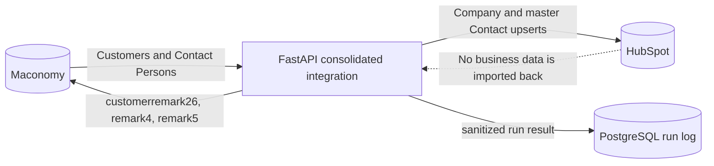
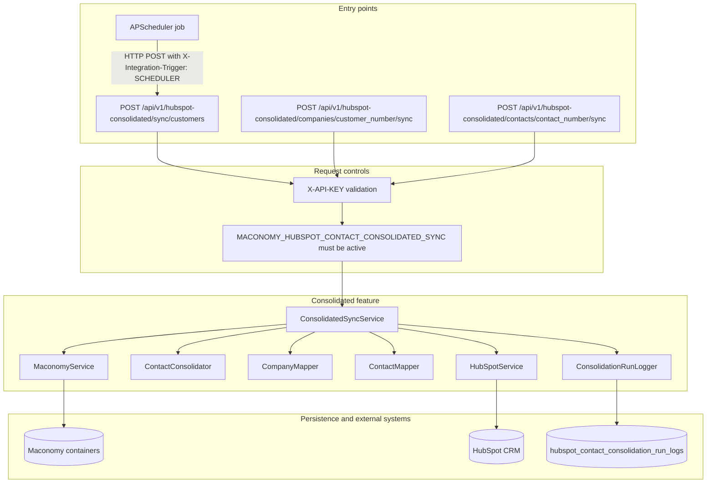
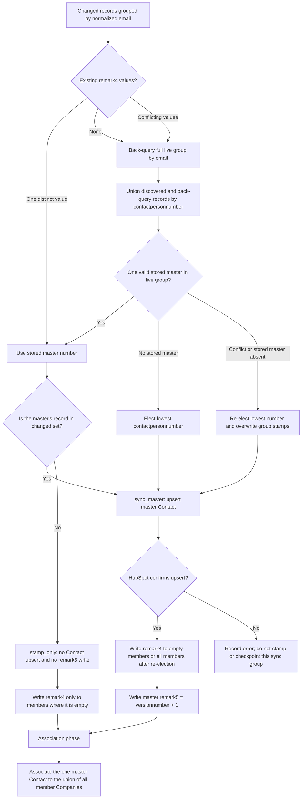
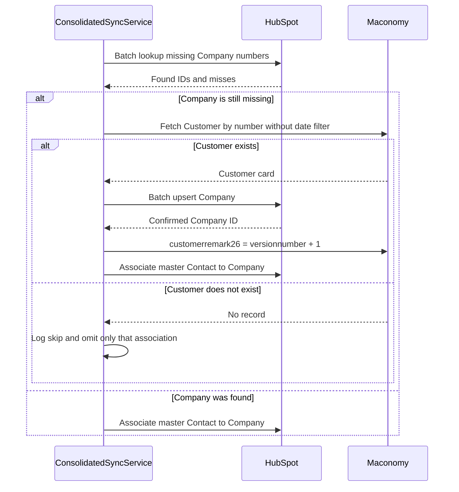
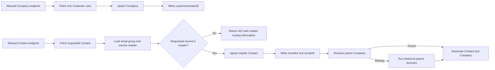
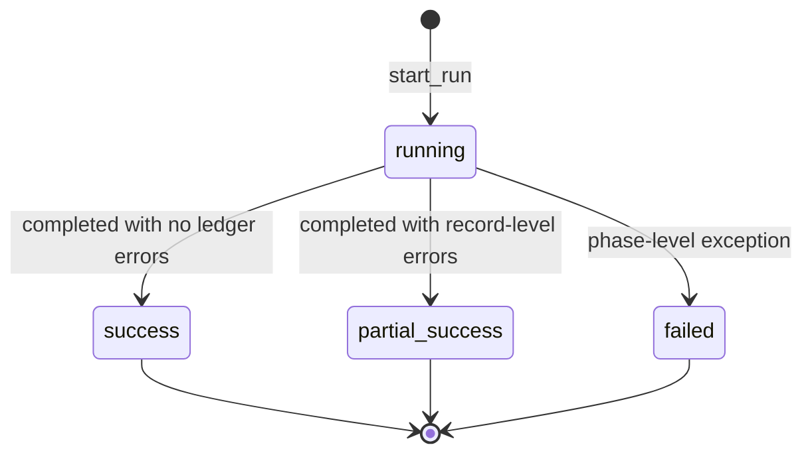

# HubSpot Consolidated Contact Integration — System Flow

## 1. Purpose and implementation boundary

This document describes the consolidated Maconomy-to-HubSpot integration implemented in:

`backend/app/features/hubspot_contact_consolidated_integration`

The feature was developed as a parallel integration so the existing `hubspot_integration` remains unchanged. Its main purpose is to represent all Maconomy Contact Persons that share an email address as one HubSpot Contact while preserving every related Company association.

The integration is one-way:



## 2. System components



### Component responsibilities

| Component | Responsibility |
|---|---|
| Routers | Expose bulk, manual Company, and manual Contact endpoints; apply API-key and active-service checks. |
| `ConsolidatedSyncService` | Own the phase ordering, branch barriers, error handling, manual flows, recovery, association, and final result. |
| `MaconomyService` | Authenticate once per run, reuse the reconnect token, discover and fetch records, classify changes, and perform optimistic-concurrency write-backs. |
| `ContactConsolidator` | Normalize email, group records, resolve or elect a master, identify stamp-only groups, and collect all parent companies. |
| Company/Contact mappers | Convert Maconomy records to HubSpot batch-upsert inputs and omit invalid inputs. |
| `HubSpotService` | Batch upsert/read Companies and Contacts, create Contact-to-Company associations, and retry rate-limited requests. |
| `ConsolidationRunLogger` | Store sanitized counts, errors, skips, successes, and group summaries keyed only by master Contact Person number. Email addresses are not persisted. |

## 3. Bulk integration flow

The bulk flow is divided into discovery, preparation, two parallel sync branches, a join barrier, and an association phase.

```mermaid
flowchart TD
    START[Bulk endpoint called] --> RUN[Create CONSOLIDATED_BULK_SYNC run log]
    RUN --> AUTH[Authenticate to Maconomy once]

    AUTH --> DISCOVERY{Parallel discovery}
    DISCOVERY --> DC[Discover active Customers changed or created in last 2 days]
    DISCOVERY --> DP[Discover Contact Persons with company and email changed or created in last 2 days]
    DC --> DWAIT[Discovery barrier]
    DP --> DWAIT

    DWAIT --> CLASSIFY[Classify by version and checkpoint]
    CLASSIFY --> CUSTOMERS[New and updated Customers]
    CLASSIFY --> CHANGED[Changed Contact Persons]
    CUSTOMERS --> NEWCONTACTS[Fetch complete Contact lists for new Customers]
    CHANGED --> UNION[Deduplicate by contactpersonnumber]
    NEWCONTACTS --> UNION
    UNION --> GROUP[Group by trimmed lowercase email]
    GROUP --> MASTER[Resolve each email group's master]

    MASTER --> SPLIT{Run branches in parallel}

    subgraph CB[Company branch]
        C1[Map Customers] --> C2[HubSpot Company batch upsert]
        C2 --> C3[Confirm IDs by source property or trace ID]
        C3 --> C4[Write customerremark26 = versionnumber + 1]
    end

    subgraph PB[Contact branch]
        P1[Select sync_master and stamp_only groups]
        P1 --> P2[Enrich master records with parent Customer name]
        P2 --> P3[Upsert only sync_master Contacts]
        P3 --> P4[Confirm master Contact IDs]
        P4 --> P5[Write remark4 master routing stamps]
        P5 --> P6[Write remark5 only for confirmed upserted masters]
    end

    SPLIT --> C1
    SPLIT --> P1
    C4 --> JOIN[Company and Contact branch join barrier]
    P6 --> JOIN

    JOIN --> LOOKCONTACT[Look up HubSpot IDs for stamp-only masters]
    LOOKCONTACT --> LOOKCOMPANY[Look up Company IDs not produced by this run]
    LOOKCOMPANY --> MISSING{Required parent still missing?}
    MISSING -->|Yes| RECOVER[Fetch historical Customer from Maconomy without date window]
    RECOVER --> RECUP[Upsert recovered Company]
    RECUP --> RECCP[Write customerremark26 checkpoint]
    RECCP --> ASSOC
    MISSING -->|No| ASSOC[Build unique master Contact to Company pairs]
    ASSOC --> LINK[Create associations in parallel with concurrency limit]
    LINK --> COMPLETE[Complete run as success or partial_success]
    COMPLETE --> RESULT[Return counts, skips, errors, checkpoints, and group summaries]
```



The association phase does not bump Contact versions. Maconomy writes in that phase occur only when a missing historical parent Customer must first be created as a normal HubSpot Company and checkpointed.

## 4. Email group and master decision

The HubSpot Contact identity remains `maconomy_contact_person_number`, but only the selected master record is sent to HubSpot. Email is the grouping key, not the HubSpot upsert key.



### Checkpoint contract

| Maconomy field | Record | Written value | Condition |
|---|---|---|---|
| `customerremark26` | Customer card | `versionnumber + 1` | HubSpot confirms the Company upsert, including recovered historical parents. |
| `remark4` | Contact Person group member | Master `contactpersonnumber` | Empty fields only; all members are overwritten only after conflict/stale-master re-election. |
| `remark5` | Master Contact Person | `versionnumber + 1` | HubSpot confirms a master Contact upsert. It is not written for stamp-only groups or associations. |

Maconomy writes use optimistic concurrency and retry one version conflict. An exhausted write-back failure is recorded without undoing already confirmed HubSpot work.

## 5. Historical parent recovery

A changed Contact can belong to a Customer outside the two-day discovery window. Recovery is demand-driven and runs only after both main branches have joined.



If the recovered Company is confirmed but its Maconomy checkpoint fails, the association can still proceed because mapping depends on the HubSpot IDs, not on the checkpoint result.

## 6. Manual flows



Manual executions create run logs with `CONSOLIDATED_CUSTOMER_RETRY` or `CONSOLIDATED_CONTACT_RETRY` and use trigger type `MANUAL`.

## 7. Scheduling and activation

The scheduler calls the bulk endpoint over HTTP and adds `X-Integration-Trigger: SCHEDULER`. It is independent of the legacy HubSpot scheduler.

| Setting | Behavior |
|---|---|
| `SCHEDULER_HUBSPOT_CONSOLIDATED_ENABLED` | Enables the new scheduled job; default is off. |
| `SCHEDULER_HUBSPOT_CONSOLIDATED_INTERVAL_MINUTES` | Controls its interval. |
| `HUBSPOT_SERVICE_KEY` | Bearer credential used for HubSpot API calls. |
| Maconomy connection settings | Used to authenticate once and reuse the `X-Reconnect` token within a run. |

The feature routers are registered under `/api/v1`, but requests still require a valid `X-API-KEY` and an active `MACONOMY_HUBSPOT_CONTACT_CONSOLIDATED_SYNC` integration service. This database switch is separate from the legacy HubSpot integration and is exposed on the monitoring screen.

## 8. Operational logging and failure behavior

Migration `20261109_0032` creates `hubspot_contact_consolidation_run_logs`, migration `20261110_0033` registers the inactive-by-default consolidated service in `integration_service`, and migration `20261110_0034` removes email addresses from existing group summaries. Each execution records its operation, trigger, status, timestamps, discovery/success counts, association and checkpoint counts, skip/failure counts, sanitized details, and failure stage. Group summaries persist only the master Contact Person number and operational counts; email addresses remain in memory only and are never written to the run-log table. The monitoring page reads these records and uses the `integration_service.is_active` flag for its enable/pause control.



Record-level mapping, lookup, association, recovery, or checkpoint problems are accumulated so unaffected records can continue. A phase-level Maconomy discovery failure or a fatal Company/Contact branch failure stops the bulk request, marks the run failed, and returns an HTTP error.

## 9. Development structure

The implementation was separated by responsibility so the flow can evolve without coupling API handling, source-system access, grouping rules, and target-system access:

```text
hubspot_contact_consolidated_integration/
├── routers/                 # bulk and manual HTTP entry points
├── services/
│   ├── sync_orchestrator.py # phases, parallel branches, barriers, and recovery
│   ├── maconomy_service.py  # discovery, reads, classification, and write-back
│   ├── hubspot_service.py   # batch APIs, lookups, rate-limit handling, associations
│   └── integration_run_log_service.py
├── mappers/
│   ├── company_mapper.py
│   ├── contact_mapper.py
│   └── contact_groups.py    # normalized-email grouping and master election
├── models/                  # consolidated run-log ORM model
├── constants.py
└── exceptions.py
```

The staged tests focus on grouping, master-resolution, and run-log privacy behavior. Deployment also requires applying Alembic migrations through `20261110_0034`; the migration files are included, but database upgrade execution remains a manual deployment step.
