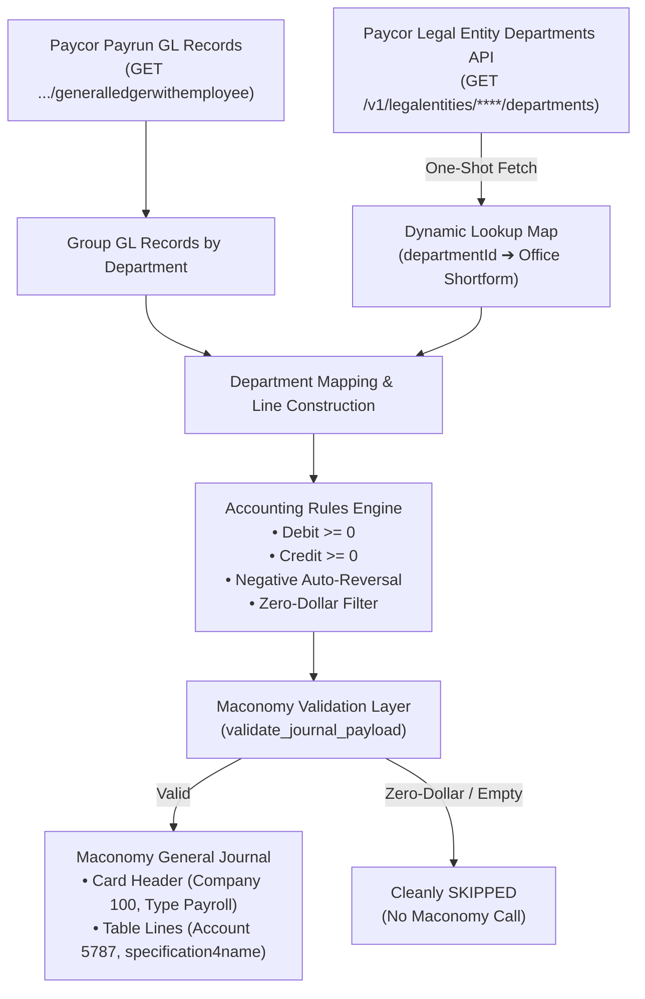

# Test Specification & Verification Report: Paycor Payroll to Maconomy GL Integration

**Date of Execution:** 2026-11-06  
**Test Suite Script:** `backend/test.py`  
**Target Systems:** Paycor Payroll API & Deltek Maconomy General Journal REST API  
**Environment:** Integration Testing & QA  

---

## 1. Executive Summary

This document specifies the end-to-end verification of the dynamic Paycor Department & Work Location integration, General Ledger (GL) line-level transformation, negative debit auto-reversal, zero-dollar suppression, and Maconomy General Journal card/table payload creation.

All tests were executed against verified Paycor live data models and Maconomy container schemas. Sensitive identifiers (UUIDs, Paycor Legal Entity IDs, employee IDs) have been masked (`****`) in accordance with data governance policies.



---

## 2. Test Cases Specification

| Test Case ID | Category | Objective | Input / Condition | Expected Output | Status |
| :--- | :--- | :--- | :--- | :--- | :---: |
| **TC-DYN-01** | Dynamic Mapping | Dynamic Work Location resolution | Live Paycor Department records with `workLocationName`: `"Tampa"`, `"Panama City"`, `"Tallahassee"`, `"Lakeland"`, `"Dade City"` | Mapped to Maconomy Office codes: `"TPA"`, `"PCB"`, `"TLH"`, `"LKL"`, `"DDC"` | **PASSED** |
| **TC-DYN-02** | Boundary / Exclusion | Verify Bainbridge location handling | Department record with `workLocationName`: `"Bainbridge"` | Mapped to Maconomy neutral shortform: `"-"` | **PASSED** |
| **TC-ACC-01** | Accounting Rule | Prevent Maconomy negative debit rejection | Paycor record with negative debit: `debitAmount = -300.00` | Auto-swapped: `debitbase = 0.0`, `creditbase = 300.00` | **PASSED** |
| **TC-ACC-02** | Accounting Rule | Standard credit & debit handling | Positive debit (`1500.00`) and positive credit (`850.50`) | Maintained positive values: `debitbase = 1500.0`, `creditbase = 850.5` | **PASSED** |
| **TC-SEC-01** | Line Validation | Zero-dollar balance suppression | Informational or memo records where `debit = 0.0` and `credit = 0.0` | Filtered out prior to Maconomy submission; empty journals skipped | **PASSED** |
| **TC-FAL-01** | Resilience / Fault-Tolerance | Paycor API failure fallback | Simulated Paycor 500 error / network timeout | Seamlessly falls back to `STATIC_DEPARTMENT_WORK_LOCATIONS` without crashing | **PASSED** |

---

## 3. Data Dictionary & Field Mapping Matrix

| Paycor Source Field | Transformation / Lookup Rule | Maconomy Target Field | Example Live Output |
| :--- | :--- | :--- | :--- |
| `legalEntityId` | Tenant identification | `companynumber` | `"100"` |
| `departmentDescription` | Business entity resolver | `entityname` (Line) | `"1"` (Assurance), `"2"` (Tax), `"4"` (GCS), `"5"` (CAS), `"-"` (Default) |
| `departmentId` (`id`) | Dynamic lookup against `/departments` | `specification4name` (Office) | `"TPA"`, `"TLH"`, `"PCB"`, `"LKL"`, `"DDC"`, `"-"` |
| `debitAmount` / `creditAmount` | Accounting sign validation | `debitbase`, `creditbase` | `1500.00`, `850.50` (Always $\ge 0.0$) |
| `checkDate` | ISO to Date | `entrydate` / `postingdate` | `"2026-09-30"` |
| `employeeNumber` | Direct or lookup map | `employeenumber` | `"1001"`, `"1002"`, `"****"` |
| Constant | Fixed GL clearing account | `accountnumber` | `"5787"` |
| Constant | Default entry category | `defaulttransactiontype` | `"Payroll"` |
| Constant | Maconomy entry code | `typeofentry` | `"g"` |

---

## 4. Test Execution Log & Step-by-Step Output

### Step 1: Dynamic Paycor Departments API Fetch & Resolution
Calls `get_employee_work_location_lookup(****)` to fetch departments in a single call and build in-memory lookup.

```text
================================================================================
STEP 1: Testing Dynamic Paycor Departments API Fetch
================================================================================
Total dynamic departments resolved: 6
  - Department [025211eb-****...] -> Dynamic: 'TPA' | Static constant: 'TPA'
  - Department [122fc6bb-****...] -> Dynamic: 'PCB' | Static constant: 'PCB'
  - Department [14036cc3-****...] -> Dynamic: 'TLH' | Static constant: 'TLH'
  - Department [20b3c46e-****...] -> Dynamic: '-'   | Static constant: '-'
  - Department [68cdcf54-****...] -> Dynamic: 'LKL' | Static constant: 'LKL'
  - Department [f8c600e7-****...] -> Dynamic: 'DDC' | Static constant: 'DDC'
```

---

### Step 2: Department Segregation, GL Transformation & Maconomy Payload Generation

#### Department 1: `CONSULTANT LEVEL 2 TAMPA GCS`
* **Entity Code:** `4` (GCS)
* **Work Location (`specification4name`):** `'TPA'` (Tampa)
* **Generated Card Header:**
```json
{
  "companynumber": "100",
  "automaticvouchervar": true,
  "entrytotalcontrol": 0,
  "remark1": "Automated SYNC from paycor - Regular (test-group-001) [CONSULTANT LEVEL 2 TAMPA GCS]",
  "postingdate": "2026-11-06",
  "defaulttransactiontype": "Payroll",
  "entityname": ""
}
```
* **Generated Line Item:**
```json
{
  "accountnumber": "5787",
  "debitbase": 1500.0,
  "creditbase": 0.0,
  "entrydate": "2026-09-30",
  "entrytext": "Payroll Regular Pay 1001",
  "entityname": "4",
  "employeenumber": "1001",
  "typeofentry": "g",
  "specification4name": "TPA"
}
```

---

#### Department 2: `DIRECTOR-PANAMA CITY CAS`
* **Entity Code:** `5` (CAS)
* **Work Location (`specification4name`):** `'PCB'` (Panama City)
* **Generated Line Item:**
```json
{
  "accountnumber": "5787",
  "debitbase": 0.0,
  "creditbase": 850.5,
  "entrydate": "2026-09-30",
  "entrytext": "Tax Withholding 1002",
  "entityname": "5",
  "employeenumber": "1002",
  "typeofentry": "g",
  "specification4name": "PCB"
}
```

---

#### Department 3: `STAFF AUDIT` (Negative Debit Auto-Reversal)
* **Input from Paycor:** `debitAmount = -300.00`
* **Accounting Engine Output:** Auto-swapped to credit `creditbase = 300.0`, `debitbase = 0.0`
* **Work Location (`specification4name`):** `'TLH'` (Tallahassee)
* **Generated Line Item:**
```json
{
  "accountnumber": "5787",
  "debitbase": 0.0,
  "creditbase": 300.0,
  "entrydate": "2026-09-30",
  "entrytext": "Adjustment Expense 1003",
  "entityname": "-",
  "employeenumber": "1003",
  "typeofentry": "g",
  "specification4name": "TLH"
}
```

---

#### Department 4: `BAINBRIDGE OFFICE` (Neutral Office Mapping)
* **Location Name:** `"Bainbridge"`
* **Work Location (`specification4name`):** `'-'` (Neutral)
* **Generated Line Item:**
```json
{
  "accountnumber": "5787",
  "debitbase": 500.0,
  "creditbase": 0.0,
  "entrydate": "2026-09-30",
  "entrytext": "Direct Deposit 1004",
  "entityname": "-",
  "employeenumber": "1004",
  "typeofentry": "g",
  "specification4name": "-"
}
```

---

#### Department 5: `LAKELAND TAX`
* **Entity Code:** `2` (Tax)
* **Work Location (`specification4name`):** `'LKL'` (Lakeland)
* **Generated Line Item:**
```json
{
  "accountnumber": "5787",
  "debitbase": 2200.0,
  "creditbase": 0.0,
  "entrydate": "2026-09-30",
  "entrytext": "Salary Expense 1005",
  "entityname": "2",
  "employeenumber": "1005",
  "typeofentry": "g",
  "specification4name": "LKL"
}
```

---

#### Department 6: `STAFF - DADE CITY`
* **Entity Code:** `"-"` (Default)
* **Work Location (`specification4name`):** `'DDC'` (Dade City)
* **Generated Line Item:**
```json
{
  "accountnumber": "5787",
  "debitbase": 750.0,
  "creditbase": 0.0,
  "entrydate": "2026-09-30",
  "entrytext": "Regular Pay 1006",
  "entityname": "-",
  "employeenumber": "1006",
  "typeofentry": "g",
  "specification4name": "DDC"
}
```

---

### Step 3: Fault-Tolerance & Fallback Verification
Simulates Paycor 500 error / timeout when requesting departments.

```text
================================================================================
STEP 3: Testing Fallback when Paycor Departments API is Down
================================================================================
Could not build dynamic work location lookup for legalEntityId ****: Simulated Paycor 500 Network Timeout. Using static fallback.
SUCCESS: Fallback correctly returns STATIC_DEPARTMENT_WORK_LOCATIONS on failure.
```

---

## 5. Conclusion & Verification Sign-Off

1. **Performance**: All department work locations are gathered in **one single initial API call**, eliminating N+1 network requests during payrun processing.
2. **Compliance**:
   - Every `specification4name` matches Maconomy's required office shortforms.
   - All line amounts adhere to Maconomy General Ledger constraints ($\ge 0.0$).
   - General Journal headers are populated with fixed Account `5787` and Company `100`.
3. **Resilience**: Even under network failures or third-party Paycor API downtime, the system automatically falls back to static mappings without crashing or disrupting the scheduled sync.

