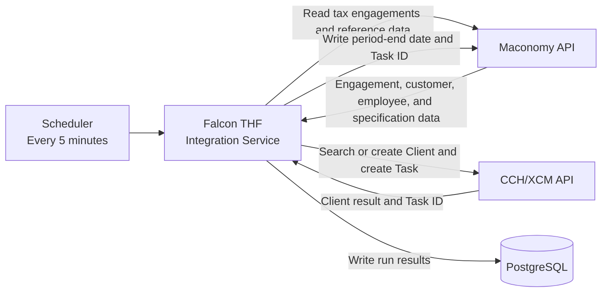
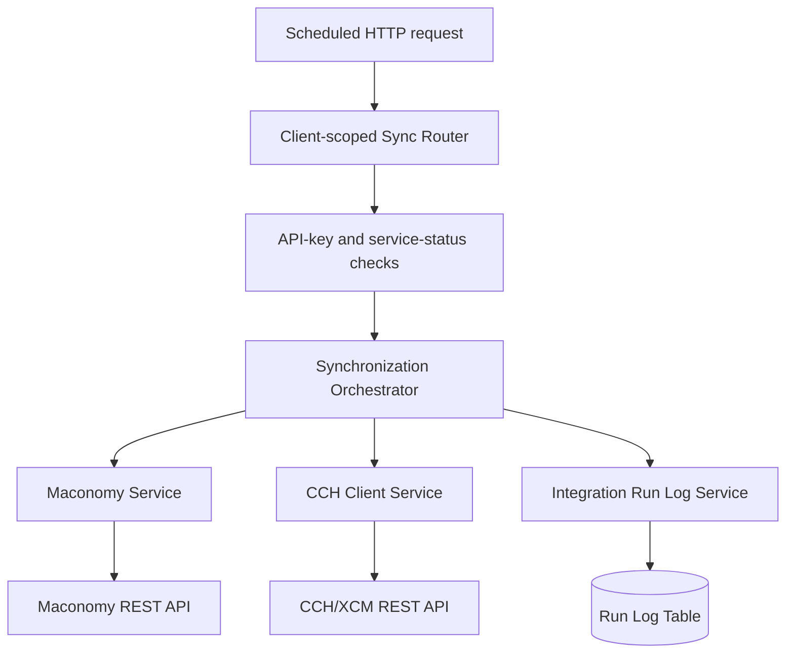
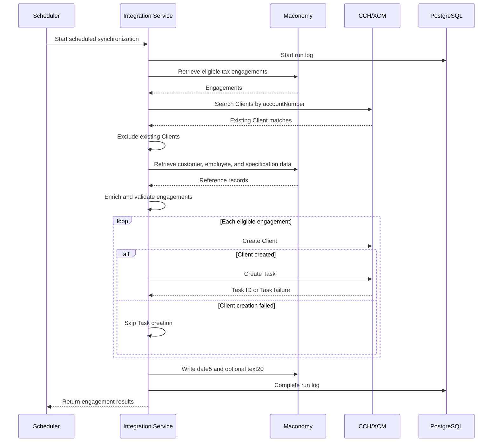
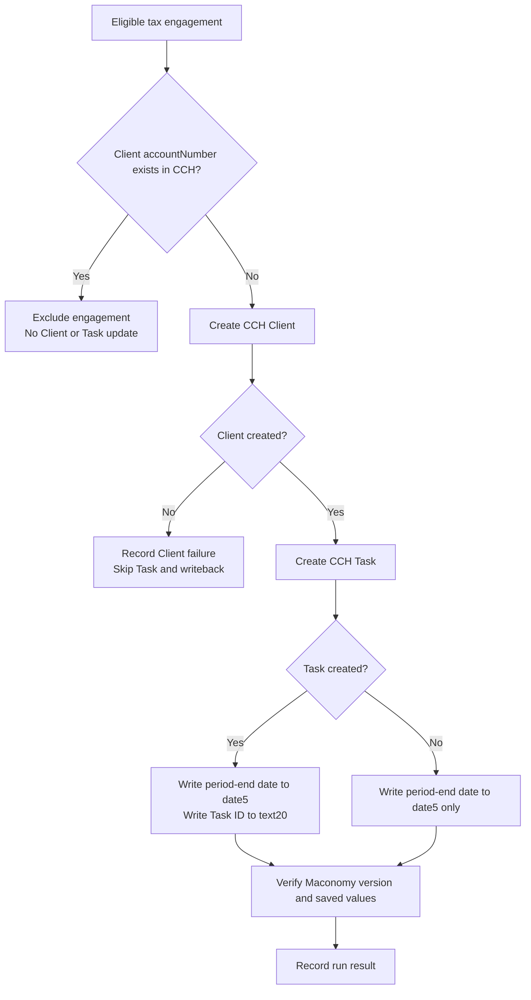

# Maconomy to CCH/XCM Integration

## System Design Document

| Document information | Value |
| --- | --- |
| Project | Falcon THF Integration Services |
| Integration | Maconomy to CCH/XCM |
| Document type | System Design |
| Status | Draft for client review |

## 1. Purpose

This document describes the technical design of the client-scoped integration
that creates CCH/XCM Clients and Tasks from eligible Maconomy tax engagements.
It covers the system architecture, components, interfaces, data controls,
security, failure handling, deployment configuration, and operational support
model.

The approved business scope and detailed requirements should be maintained
separately. This document explains how the integration is built and operated.

## 2. System context

Maconomy is the system of record for tax-engagement and client information. A
tax engagement is identified by Maconomy `locationname = 2`. For each eligible
new engagement, the integration creates one CCH Client and one Task for that
Client, then writes the processing result back to Maconomy.

### System responsibilities

| System | Responsibility |
| --- | --- |
| Scheduler | Starts the integration every five minutes. |
| Maconomy | Owns tax-engagement, customer, employee, specification, fiscal-period, and writeback information. |
| Integration Service | Selects eligible engagements, enriches reference data, validates prerequisites, creates CCH records, and coordinates writeback. |
| CCH/XCM | Stores the Client and its associated Task. |
| PostgreSQL | Stores integration-service status and monitoring records. It does not determine whether an engagement is eligible. |

## 3. Application architecture

### Component design

| Component | Technical responsibility |
| --- | --- |
| Client-scoped Sync Router | Receives the synchronization request, starts the run log, coordinates each processing stage, and returns engagement-level results. |
| Maconomy Service | Authenticates, discovers tax engagements, retrieves reference data, enriches jobs, calculates period-end dates, validates eligibility, and performs controlled writeback. |
| CCH Client Service | Authenticates with CCH, searches for existing Clients, creates new Clients, creates Tasks, and normalizes CCH failures. |
| Integration Run Log Service | Records run totals, successful engagement numbers, failed stages, and engagement-level failure details. |
| Service-status control | Allows the CCH integration to be enabled or disabled without redeploying the application. |

## 4. Interface design

### Integration endpoint

| Item | Design |
| --- | --- |
| Method and path | `POST /api/v1/xcm-cch-client-scoped/sync` |
| Scheduled request | `{ "jobnumbers": null }` |
| Controlled selection | An explicit array of Maconomy engagement numbers can be supplied. |
| Authentication | Integration API key |
| Service control | `MACONOMY_CCH_XCM_CLIENT_SCOPED` must be active |
| Successful result | List of processed engagement results |
| Upstream failure | Returned as HTTP `502` with the failed processing stage recorded in the run log |

### Maconomy interfaces

| Interface | Purpose |
| --- | --- |
| Authentication | Obtains an X-Reconnect token. |
| Jobs filter | Retrieves eligible tax engagements. |
| Customer filter | Retrieves customer name, fiscal year-end month, and individual-name fields. |
| Employee filter | Resolves assigned employee numbers to email addresses. |
| Specification filters | Resolves Client Type and Return Type descriptions. |
| Job instance and bind | Reads the latest version before writeback. |
| Job card update | Writes the calculated period-end date and, when available, the CCH Task ID. |

### CCH/XCM interfaces

| Interface | Purpose |
| --- | --- |
| User authentication | Obtains a bearer token using the configured API key and CCH user credentials. |
| Advanced Client search | Finds existing Clients by exact `accountNumber`. |
| Client creation | Creates a new Individual or Entity Client. |
| Task creation | Creates one Task for a newly created Client. |

## 5. Processing design

### 5.1 Engagement discovery

The scheduled run requests Maconomy engagements that meet all of the following
conditions:

- `template = false`
- `locationname = 2`
- `closed = false`
- `text20` is empty
- `createddate` is within the configured new-engagement discovery period

Maconomy returns at most 5,000 records from the filter request. The integration
passes the first 40 eligible engagements to the CCH Client lookup in one run.

### 5.2 End-to-end sequence

### 5.3 Eligibility validation

After reference-data enrichment, the engagement must have:

- A Billing Manager email resolved from `employeenumber6`.
- A CSE or Engagement Executive email resolved from `specification5name`.
- An Engagement Partner email resolved from `purposename`.
- A non-blank Return Type that is not `default`.

An engagement that fails validation is marked ineligible. Client creation,
Task creation, and Maconomy writeback are skipped for that engagement, while
other engagements continue.

### 5.4 Create and writeback sequence

## 6. Decision logic

| Condition | Action |
| --- | --- |
| Engagement does not satisfy the Maconomy discovery conditions | Exclude it from the run. |
| CCH Client already exists for the engagement number | Exclude it; do not update the Client or create a Task. |
| Required role email is missing | Mark the engagement ineligible. |
| Return Type is blank or `default` | Mark the engagement ineligible. |
| Client creation fails | Record the failure, skip Task creation, and skip Maconomy writeback. |
| Client creation succeeds and Task creation succeeds | Write the period-end date to `date5` and Task ID to `text20`. |
| Client creation succeeds but Task creation fails | Write only the period-end date to `date5`; leave `text20` unchanged. |
| Maconomy changes before writeback | Re-read the engagement and retry the version-controlled write once. |

## 7. Data design

### 7.1 Reference-data enrichment

| Enriched value | Maconomy source |
| --- | --- |
| Fiscal year-end month | Related customer `fiscalyearendmonth` |
| Period-end date | Last day of `theyear` and the fiscal year-end month |
| Client Type description | Specification 1 description |
| Return Type | Specification 2 description |
| Billing Manager email | Employee email for `employeenumber6` |
| CSE email | Employee email for `specification5name` |
| Engagement Partner email | Employee email for `purposename` |

The calculated period-end date is formatted as `MM/DD/YYYY` for the CCH
payload and converted to `YYYY-MM-DD` when saved to Maconomy `date5`.

### 7.2 CCH Client mapping

| CCH field | Maconomy or calculated source | Rule |
| --- | --- | --- |
| `accountNumber` | `jobnumber` | Unique Client lookup key. |
| `clientType` | Specification 1 description | `Individual` when the description is `individual`; otherwise `Entity`. |
| `last_Entity_Name` | Customer `name1` or individual last name | Uses the individual last name when valid individual-name data is available; otherwise customer name. |
| `firstName` | `customerremark27` | Sent for an Individual when first and last names are present. |
| `middleName` | `customerremark28` | Optional Individual middle name. |
| `last_Entity_Name` | `customerremark29` | Individual last name. |
| `suffix` | `customerremark30` | Optional Individual suffix. |
| `responsiblePerson` | Billing Manager email | Resolved from `employeenumber6`. |
| `emailId` | `electronicmailaddress` | Client email address. |
| `phoneNumber` | `telephone` | Client telephone number. |
| `primaryTask` | Return Type | Specification 2 description. |
| `periodEndDate` | Calculated period-end date | Last day of the fiscal year-end month. |
| `auditPartner` | CSE email | Resolved from `specification5name`. |
| `taxPartner` | Engagement Partner email | Resolved from `purposename`. |
| `originatingLocationName` | Fixed value | `HQ` |
| `active` | Fixed value | `Y` |

### 7.3 CCH Task mapping

| CCH field | Maconomy or calculated source | Rule |
| --- | --- | --- |
| `accountNumber` | `jobnumber` | Links the Task to the newly created Client. |
| `taskType` | Return Type | Specification 2 description. |
| `periodEndDate` | Calculated period-end date | Time `00:00:00` is appended for the CCH request. |
| `taskDescription` | `description1` | Falls back to `jobnumber` when the description is blank. |

### 7.4 Maconomy writeback

| CCH processing result | Maconomy update |
| --- | --- |
| Client and Task created | Write `date5` and `text20`. |
| Client created but Task failed | Write `date5` only. |
| Client creation failed | No writeback. |
| Engagement is ineligible | No writeback. |
| Client already exists | Engagement is excluded before writeback. |

`text20` stores the CCH Task ID and is also used to exclude an engagement from
future creation runs.

### 7.5 Run log

The `xcm_cch_client_scoped_run_logs` table stores:

- Request ID, trigger type, status, and Maconomy instance.
- Start and completion timestamps.
- Jobs discovered, succeeded, and failed.
- Clients and Tasks created.
- Maconomy writebacks completed.
- Summary, failure stage, error message, and structured diagnostic details.

## 8. Security design

| Area | Design |
| --- | --- |
| Integration endpoint | Protected by the application's API-key validation. |
| Service availability | Protected by a database-backed integration-service status check. |
| Maconomy authentication | Uses configured credentials to obtain an X-Reconnect token. |
| CCH authentication | Uses the configured CCH API key, username, and password to obtain a bearer token. |
| Secret handling | Credentials and API keys are loaded from protected runtime configuration and are not stored in documentation or logs. |
| Transport | Production connections should use HTTPS for external API communication. |

## 9. Reliability and consistency controls

### Duplicate control

- Maconomy `jobnumber` maps to CCH `accountNumber`.
- CCH is searched before Client creation.
- Only exact account-number matches are treated as existing Clients.
- Client searches are divided into batches of 20 account numbers.

### Writeback concurrency control

Before updating Maconomy, the service verifies the engagement version read
during discovery. If the version has changed, the engagement is re-read and
the write is retried once with the new version. After the update, the service
verifies that:

- The Maconomy version increased by exactly one.
- `date5` contains the expected period-end date.
- `text20` contains the expected Task ID when Task creation succeeded.

### Failure isolation

Client and Task creation results are tracked independently for each
engagement. A failure for one engagement does not stop later engagements when
processing can continue. Route-level failures are recorded with the stage at
which processing stopped.

### Transaction boundary

There is no distributed transaction across Maconomy and CCH. CCH Client and
Task creation occurs before Maconomy writeback. A writeback failure is recorded
for operational follow-up.

## 10. Deployment and configuration

The integration is deployed as part of the Falcon THF Integration Services
application. Environment-specific configuration supplies:

- Maconomy base URL, instance short name, username, and password.
- CCH/XCM base URL, API key, username, and password.
- Accepted integration API keys.
- PostgreSQL connection settings.
- Scheduler enablement, API base URL, API key, timeout, and five-minute CCH
  interval.

The CCH integration has a separate service-status record. The service must be
enabled before scheduled requests are accepted.

In the current scheduler sequence, the CCH integration runs before the
CaseWare Cloud integration. The CaseWare run proceeds only when the CCH run
completes successfully.

## 11. Monitoring and support

Operational monitoring should review:

- Scheduled execution status and trigger type.
- Engagements discovered, succeeded, and failed.
- Clients and Tasks created.
- Maconomy writebacks completed or failed.
- Failure stage and engagement-level error details.

Recommended support sequence:

1. Confirm that the integration service and scheduler are enabled.
2. Review the run summary, failure stage, and failed engagement details.
3. Confirm the engagement satisfies the Maconomy discovery conditions.
4. Confirm the required employee role emails and Return Type.
5. Search CCH using the engagement number as `accountNumber`.
6. Review Maconomy `date5`, `text20`, and `versionnumber`.
7. Correct the underlying data or service issue and follow the approved
   recovery process.

## 12. Technical constraints and assumptions

### Constraints

- A Maconomy filter request returns at most 5,000 records and does not paginate.
- At most 40 eligible engagements are passed to CCH lookup in one run.
- The integration creates CCH records only when the Client does not already
  exist; existing Clients are not updated.
- A Task is created only after the Client is created successfully in the same
  run.
- The integration does not search for an existing Task.
- If Client creation succeeds but Task creation fails, the next scheduled run
  detects the existing Client and excludes the engagement. Automatic Task-only
  recovery is not implemented.
- No distributed transaction spans Maconomy and CCH.

### Assumptions

- Maconomy engagement numbers are unique and stable.
- Tax engagements use `locationname = 2`.
- Required customer, employee, and specification reference records are
  maintained in Maconomy.
- Assigned employee numbers resolve to valid email addresses.
- Fiscal year-end month and engagement year produce a valid period-end date.
- Network access to Maconomy, CCH/XCM, and PostgreSQL is available from the
  integration environment.

## 13. Scope reference

The implemented technical design supports creation of one CCH Client and one
Task for each eligible new Maconomy tax engagement. It does not update existing
CCH Clients or Tasks.

Employee-time synchronization from Maconomy to CCH is excluded from the
current phase. The selected Tasks and the associated staffing and role mapping
for time synchronization will be defined as part of Phase 2.
